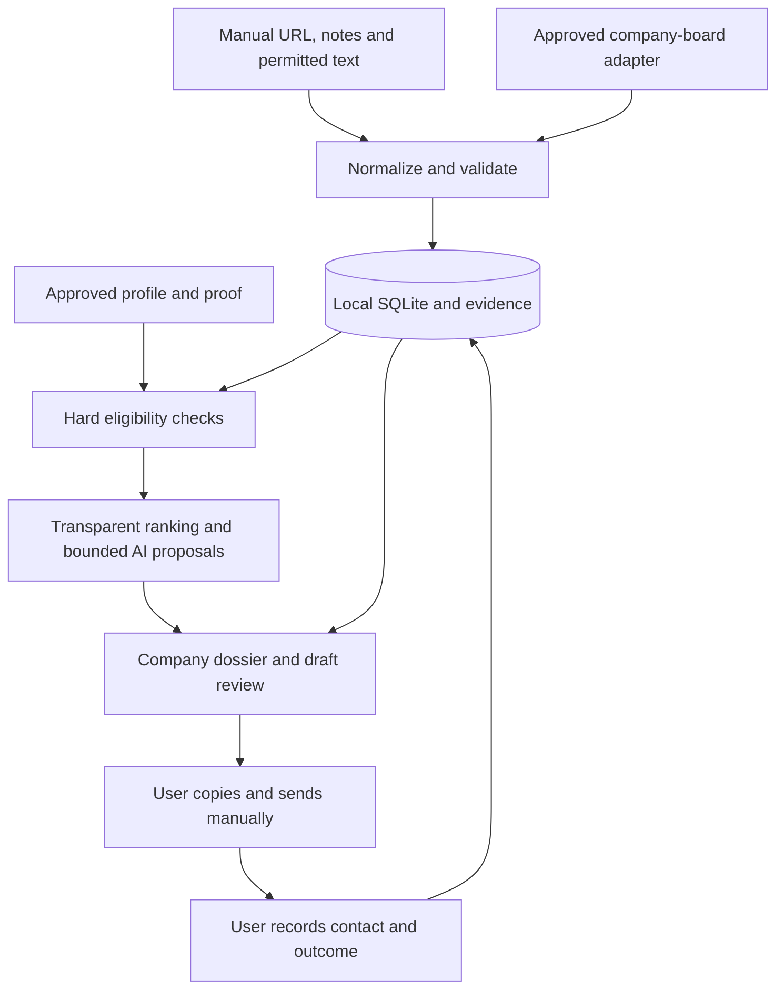

# Jobmaxxing: Founder-First Opportunity Intelligence

- **Status:** Proposed; awaiting product and architecture review.
- **Document date / documentation checked:** 2026-10-15.
- **Delivery scope:** Requirements and architecture only. Implementation requires separate approval.
- **Primary user:** A developer conducting a personal, founder-focused job search.
- **Product intent:** A local-first, open-source tool; personal data and credentials stay outside the source repository.

## 1. Product definition

### Problem

Promising engineering opportunities are scattered across startup job boards, founder posts, company websites and GitHub. Evaluating one opportunity requires repeatedly checking the company, the hiring signal, eligibility, the decision-maker and which genuine project best demonstrates fit. Generic application tools optimize submission volume and lose the evidence needed for a useful conversation.

Jobmaxxing should reduce that research and writing work while leaving judgment and communication with the user. It should help answer: **Is this company worth a conversation, can I credibly contribute, and what evidence should I mention?**

### Product in the user's workflow

1. Find or import a founder post, startup role or company of interest.
2. Attach it to a company dossier, retaining the original evidence and its age.
3. Check hard constraints before considering relevance.
4. Compare the company's needs with the user's approved skills and project proof.
5. Review a short explanation, missing information and a published professional contact path.
6. Edit a concise, supported message; copy it and send it manually if appropriate.
7. Record the contact, reply and eventual outcome.

The company is the organizing unit. A post is evidence; an opportunity is a particular role or explicitly unconfirmed conversation possibility at that company. Several posts may support one opportunity, and one company may have several distinct roles.

### Differentiators

- Founder and engineering-leader signals receive explicit attention alongside verified vacancies.
- A company dossier joins information across sources without collapsing distinct roles.
- Matching points to real portfolio evidence, not just shared keywords.
- Facts, user statements, model interpretations and unresolved conflicts remain distinguishable.
- Drafts include their evidence, contact provenance and uncertainty in the review view.
- Manual capture remains useful when a source blocks or does not authorize automation.
- One local installation works without a cloud account, autonomous agent or sending integration.

### Non-goals

- Application volume targets, bulk campaigns, automatic follow-ups or autonomous outreach.
- A LinkedIn Jobs clone, general recruiting platform or universal web crawler.
- Scraping restricted platforms, cookie reuse, fake accounts, anti-bot evasion or proxy rotation.
- Guessing email addresses, purchasing contact lists or collecting unrelated personal information.
- Fabricating experience, rewriting a resume without approval or treating repository ownership as proof of personal contributions.
- SaaS accounts, billing, tenancy, team collaboration, hosted deployment or shared databases.
- Vector search, learned ranking models, message brokers, microservices or required multi-agent orchestration.
- Legal determinations about employment eligibility or guaranteed interview outcomes.

### Success criteria

The primary outcome is a useful shortlist and better prepared conversations. Messages sent are an outcome to record, not a target to maximize.

For a small owner-reviewed pilot, propose the following targets before collecting results:

| Measure | Initial target | Interpretation |
| --- | --- | --- |
| Usefulness of highest-ranked opportunities | At least 7 of the top 10 marked worth investigating | Owner judgment; show the denominator and all labels |
| Research-to-reviewed-draft time | At least 30% below a timed manual baseline over 10 comparable cases | Include correction time; compare like-for-like cases |
| Critical factual errors in reviewed drafts | Zero invented credentials, contacts or confirmed-vacancy claims | Any occurrence blocks release until corrected and regression checked |
| Safety invariants | All eligibility, approval and privacy checks pass | A high ranking cannot compensate for an invariant failure |
| Hiring classification | Precision and recall reported by signal class on the frozen evaluation set | No aggregate score hides false confirmed vacancies |

These are proposed acceptance targets, not measured results. Record replies and interviews, but a small personal pilot cannot establish causal hiring impact.

## 2. MVP boundary

### Smallest useful end-to-end release

The MVP is a single local web application with one active profile. It supports manual capture from all priority sources, one permitted automated source, transparent qualification, bounded AI assistance, an editable review packet and manual outcome tracking.

| Included in MVP | Boundary |
| --- | --- |
| Manual capture | Source URL, user's notes, known date and text the user has permission to process; URL-only records are valid |
| YC, Wellfound, LinkedIn and X source labels | Common normalized records; importing a URL never implies permission to fetch it |
| Greenhouse watchlist refresh | User-selected company boards only; explicit refresh, after access/use review; no global board enumeration |
| Company dossiers | Company identity, product, people, roles, supported technology claims, professional channels and evidence |
| One profile and proof library | User-approved profile fields and proof points entered locally; links and authorized text first |
| Qualification and ranking | Deterministic constraints and visible weights; AI proposes extraction and fit explanations |
| One initial model adapter | Prefer a local Ollama endpoint if hardware and evaluated quality permit; disabled/manual mode always works |
| Outreach drafts | Founder introduction, hiring email, short LinkedIn/X message, hiring-post response and application text using a shared drafting flow |
| Review and tracking | Edit, approve for manual use, copy, explicitly mark contacted, record replies and outcomes |
| Operational controls | Source enable/pause, stop new external reads/model requests, visible failures and usage history |
| Local durability | SQLite persistence, restart recovery, schema migrations and a documented backup/restore procedure |

For restricted sources, users can retain their own observations and source references without copying protected material. Text import is available only where the user has the necessary rights. Manual import is not a permission workaround. A restricted reference can be corroborated through a permitted company page or an authorized source.

The complete MVP includes manual capture plus the Greenhouse watchlist. If board-use permission is unresolved, the manual workflow can be piloted independently, but the automated slice must be reported as blocked or deferred rather than complete.

### Explicitly deferred

- Ashby automatic collection, after the first adapter and manual workflow prove useful.
- General career-page fetching or structured JobPosting extraction; retain manual references initially.
- Automated YC, Wellfound or LinkedIn collection unless an authorized interface and use are verified.
- Paid X API or xAI X Search discovery, Hermes research, cloud model providers and any paid integration.
- Scheduling: add a user-started local scheduled command only when repeated manual refresh demonstrates a need; no daemon in the first release.
- PDF/DOCX resume parsing, GitHub account-wide ingestion, repository cloning and code execution.
- Email/DM/application sending, inbox sync and browser automation.
- Multiple active users, remote access, public dataset export and public hosting.

### Example MVP session

The user saves a LinkedIn founder-post URL and a note about a possible engineering opening. The tool does not fetch LinkedIn. The user adds permitted company material and verifies the founder's role. A linked employer board corroborates an opening. Qualification flags an unresolved location restriction; the item stays in Researching. After the user confirms eligibility from evidence, the tool ranks the opportunity, selects an approved project proof point and prepares a message. The user reviews the packet, edits and approves the exact text, copies it, sends it outside the tool and records the contact. A later reply is recorded manually.

Without corroborating a vacancy, the same company can remain an unconfirmed research lead. Its message must ask about possible needs without claiming the company has an opening.

## 3. Requirements and product rules

### R1. Capture and normalize hiring evidence

- Every signal retains source platform, acquisition method, original URL, native ID when available, observed collection time, publication time when available, employer attribution and supporting evidence.
- Publication time may be null. Collection, update and last-publication timestamps must not be relabeled as original publication dates.
- A URL-only import creates an incomplete reference, not an invented post body or verified opportunity. Display missing employer, date and evidence explicitly.
- Preserve the user's source URL; maintain a separate conservative canonical key for duplicate checks. Remove known tracking parameters only; retain parameters that identify content.
- Classify signals as `verified_vacancy`, `explicit_hiring_announcement`, `indirect_unconfirmed`, `not_hiring` or `uncertain`. Store the evidence and reason for classification.
- A verified vacancy requires a current, attributable employer/ATS role or an explicit role-specific announcement corroborated by an authorized representative. A general founder hiring post is not automatically a verified vacancy.
- Funding news, product launches, growth, old hiring posts, job-seeking posts, recruiter advertisements and talent pools do not establish an open role.
- Separate hiring certainty from employment type: full-time, part-time, internship, contract, freelance, temporary or unknown.
- Retain observed updates as evidence revisions when storage is permitted. Re-importing unchanged content must not create duplicate signals or opportunities.
- A failed refresh never proves a role closed. Missing listings after a successful complete refresh become `possibly_removed`; explicit closure or user verification establishes `closed`. Show last successful verification.

### R2. Company and person dossiers

- Company identity uses a verified company-controlled domain or corroborated native identifiers; names alone generate possible duplicate suggestions.
- Normalize casing, IDN representation, trailing slashes and a verified `www` alias. Do not collapse arbitrary subdomains, shared hosting domains, subsidiaries or same-name companies.
- Preserve source identities and an explicit alias/merge history. A user-confirmed merge must preserve notes, evidence, roles, drafts and outreach history; support correcting a mistaken association.
- Founder and leadership affiliations need evidence and observation dates. A shared name or a social handle alone does not establish identity or employment.
- The dossier presents product, verified stage/batch, people, open roles, technologies and plausible challenges. Each statement is labeled `supported`, `user_asserted`, `interpretation`, `unknown` or `conflict`.
- `supported` means attributable evidence exists, not independently guaranteed truth. Confidence must state its basis; model confidence is not a probability of truth.
- Contact channels are restricted to explicitly published professional/hiring channels with a source, intended purpose and last verification time. An application URL is a valid fallback; a public social profile does not prove its DMs are open.
- Record contact preferences and do-not-contact status. Never infer an address from a domain/name pattern or use private or unrelated personal data.

### R3. Profile and proof library

- Store skills, preferences, target roles, experience, location/timezone, work authorization, remote/onsite preferences, employment types and optional compensation constraints locally.
- Hard preferences must be entered or confirmed by the user. Blank means unknown, not unrestricted. The user's actual constraints have not been supplied in this brief.
- Proof points contain a specific capability claim, project/contribution link, contribution description, supporting evidence and approval state. Repository ownership alone is insufficient.
- An inferred profile update or resume extraction is a proposal. Show the exact changes and require explicit save/approval before replacing profile facts.
- The AI may reference only approved proof points and approved profile fields. It must not add experience, metrics, credentials or claims of production use.
- Keep a profile revision on each match and draft. Changing hard constraints triggers reevaluation; changing proof invalidates affected draft approvals.
- Include `profile_id` in user-specific records, but expose one active profile and no account/tenant infrastructure.

### R4. Qualification before relevance

Each hard constraint returns `pass`, `fail`, `unknown` or `conflict`, with reasons and evidence. These include work authorization, geography, time overlap, work arrangement, employment type and any user-designated hard seniority or compensation restriction.

- Any hard failure yields `ineligible` and excludes the item from the qualified shortlist.
- An unresolved hard constraint yields `needs_review`. It may be researched but must not silently become eligible or Ready for Review.
- All applicable hard constraints passing yields `eligible`. A profile must first explicitly define which constraints apply; an empty profile cannot pass by default.
- AI cannot override these outcomes. A user may correct facts or deliberately change a preference with an audit note; there is no score-based bypass.
- Remote does not imply worldwide eligibility. Unknown salary is not a salary match, and missing seniority is not evidence of junior suitability.
- Closed roles, do-not-contact channels and unsupported company identities cannot enter the ready queue.

Rank only after displaying eligibility. Use visible, editable weights and discrete factors with reasons. Initial proposed weights sum to 100:

| Factor | Weight | Evidence required |
| --- | --- | --- |
| Demonstrable project fit | 30 | Approved proof points mapped to actual needs |
| Required and preferred skill fit | 20 | Requirement excerpts; required and preferred kept separate |
| Company/product interest | 15 | User preferences and supported company description |
| Hiring signal strength | 15 | Classification and employer/author attribution |
| Freshness | 10 | Actual publication/verification basis and visible age |
| Professional contact path | 10 | Verified intended business channel or application route |

Use factor values `0`, `0.5`, `1` for absent/weak, partial and strong support, multiplied by weight. Unknown receives zero contribution with an explicit missing-data label; it is not a negative factual assertion. Do not renormalize around missing factors. Show evidence coverage separately. No model produces an opaque overall score.

For the initial freshness rule, use 1 for a dated signal within 14 days, 0.5 within 30 days and 0 thereafter. A successfully checked live role can receive 0.5 for current availability when its publication date is unknown, labeled with that distinct basis. Future/invalid dates require review. These thresholds are adjustable product defaults to evaluate, not facts about hiring behavior.

Unconfirmed leads retain an `unconfirmed` label in every view and sort separately from confirmed roles by default. No score promotes them into a vacancy. Stable ties use evidence coverage, then last verification time, then record ID. Show reasons against a match as prominently as reasons in favor.

### R5. Research and AI contracts

- Separate `extract_signal`, `assess_fit` and `draft_message` operations behind a small model interface. No agent framework is required.
- Inputs reference bounded excerpts, approved proof points and relevant profile fields. Outputs use versioned schemas, allowed enums, explicit nulls, evidence references and uncertainty.
- Validate response shape, size, referenced IDs, evidence ownership and supported values in application code before accepting any result. Reject unknown fields where appropriate.
- An evidence ID must refer to the relevant input and actually support the proposed claim. Shape validation alone does not establish accuracy; unresolved semantic claims remain interpretations for human review.
- Provider output never directly changes hard preferences, approves a draft, selects a new external destination or triggers a send.
- Malformed output or timeout preserves the source record and exposes an error. Permit at most one explicit bounded retry; no silent provider fallback, unbounded repair loop or hidden paid call.
- Record provider/model identifier, prompt/schema versions, input evidence/profile revisions, timestamps and available usage. Mark unavailable token/cost data unknown, never zero by assumption.
- Reuse an accepted result only for the same input/profile/prompt/model revisions. Do not build a generalized cache service.

### R6. Drafting, review and manual communication

Every draft review packet contains the company and opportunity, signal status, eligibility reasons, cited company detail, contact-channel provenance, selected proof point, proposed recipient/channel and exact draft text. An unknown contact remains unresolved rather than being invented.

- Select one specific need and one convincing approved proof point. Prefer natural, concise language; initial targets are 60–140 words for email and 25–70 for short social messages. These are editing guidelines, not claimed platform limits.
- Never claim personal familiarity, praise unsupported achievements, invent project metrics or describe an indirect signal as an opening.
- For a general application form, bind the draft to the exact published form URL and field purpose. Do not require an individual recipient where the intended channel is a verified form or team address.
- Draft state is `editing`, `approved_for_manual_use`, `stale` or `archived`. Approval is a distinct user action against a frozen draft revision, recipient/destination and channel.
- Editing subject/body, recipient, channel, proof, critical evidence or profile facts invalidates the approval. Revocation is available locally.
- Copying and approval do not mean a message was sent. The user must explicitly record actual contact, destination, time and message snapshot; if the externally sent text differs, record that actual text as user-reported history.
- Show prior contact and suppression status before approving or copying. Block approval for an active do-not-contact destination. Warn about a previous contact to the same person/channel/company, including across duplicate opportunities.
- Clipboard copy is always a user gesture. Provide a selectable-text fallback if clipboard permission is unavailable. Do not prefill an auto-submitting external form.
- The MVP contains no sending tool, sending credentials, mail client integration or automatic application submission.

**Future sending invariant, outside MVP:** A separate executor must atomically validate an unexpired, unrevoked, single-use approval binding the exact recipient, channel, subject/body and attachments hash, draft revision and current suppression state. Changed content needs new approval. Persist an idempotency key and approval consumption with the attempt. An ambiguous provider timeout becomes `delivery_unknown` and requires reconciliation rather than an automatic retry. An agent's tool/command approval is not outreach approval.

### R7. Dashboard and feedback

The default view is a compact company/opportunity list with eligibility, signal status, priority explanation, evidence age, workflow stage and next unresolved question. Filters include source, employment type, eligibility, confirmed/unconfirmed, stage, saved/priority and dismissed. A dossier detail view and a draft review view complete the core interface; no separate analytics product is needed.

Default workflow:

`Discovered → Qualified → Researching → Ready for Review → Contacted → Replied → Interviewing → Closed`

- `Qualified` means deterministic eligibility passed; research may begin from Discovered while missing constraints are resolved.
- `Ready for Review` requires eligible status, an attributable opportunity, a suitable contact path and a draft packet. Unconfirmed leads remain labeled and use an exploratory draft.
- `Contacted` requires an explicit manual outreach/application event. Copy, draft approval or opening a source cannot cause it.
- Replied and Interviewing require user-recorded events. Closed records a reason such as not interested, ineligible, filled, rejected, accepted or no longer pursuing.
- Stages can be corrected with a history entry; do not fabricate skipped events. Save, dismiss and manual priority are separate flags.
- Persist notes and explicit feedback: relevant/irrelevant, interested/not interested, bad-match reason, contacted, positive/negative reply and outcomes.
- Feedback is profile-specific. Initially use it for suppression, user-visible preference edits and evaluated weight changes. Do not automatically retrain or silently alter hard constraints.
- Use labeled forms, keyboard access, visible focus, readable contrast and text labels alongside status colors. Show empty, error, stale, paused and model-disabled states.

## 4. Architecture proposal

### Runtime and components

Use one Python application, one SQLite database and a small server-rendered dashboard. No stack exists in the currently empty project directory; these are proposals rather than constraints inherited from code.

| Component | Proposed implementation | Responsibility |
| --- | --- | --- |
| Local UI and application routes | FastAPI, Jinja2 and simple CSS | Forms, list/detail views, review and operational controls |
| Source adapters | Small Python modules; manual import plus Greenhouse first | Authorized acquisition and a common normalized signal contract |
| Persistence | Python `sqlite3`, numbered SQL migrations, parameterized queries | Domain records, provenance, revisions and run history |
| Qualification/ranking | Plain Python functions | Hard constraints, transparent factors and stable ordering |
| Model adapter | HTTPX plus local Ollama initially, subject to evaluation | Structured extraction, relevance suggestions and drafting |
| Validation | Pydantic schemas and explicit semantic checks | Validate untrusted source/model boundaries |
| Research | User-supplied material and official source records | Evidence-backed dossier updates; optional Hermes later |
| Communication | Review/copy and manual event recording | Exact draft review; no executor in MVP |

FastAPI documents Jinja2 templates; Python documents SQLite as a disk database without a separate server. Pydantic provides model validation, HTTPX provides configurable timeouts, and Ollama documents schema-constrained local outputs. These capabilities justify the proposed small stack; they do not prove end-to-end quality or hardware fit. [FastAPI templates](https://fastapi.tiangolo.com/advanced/templates/), [Python SQLite](https://docs.python.org/3/library/sqlite3.html), [Pydantic models](https://docs.pydantic.dev/latest/concepts/models/), [HTTPX timeouts](https://www.python-httpx.org/advanced/timeouts/), [Ollama structured outputs](https://docs.ollama.com/capabilities/structured-outputs).

Use a supported Python version tested on Windows during implementation; do not select a version or model solely because documentation exists. Dependencies should be pinned and licenses checked when the implementation is approved. Avoid an ORM, frontend build pipeline and generalized plugin registry until an actual requirement justifies them.



### Data flow and failure boundaries

1. A manual import or explicit watchlist refresh creates a durable run record and acquisition metadata. Restricted URLs are stored as references without server fetching.
2. The adapter reads outside any write transaction. Enforce source-specific timeout, bounded response size and item limits; distinguish a complete fetch from a partial response.
3. Normalize identity and content, validate and transactionally save each accepted item with its evidence. Quarantine invalid items with a reason; never silently lose them.
4. Resolve company associations conservatively. Ambiguous employers remain unresolved until corrected.
5. Apply deterministic eligibility; model extraction and fit proposals must pass the same evidence and schema checks before use.
6. Persist a versioned assessment and draft, then let the user review them. Local edits remain available when external services fail.

Run one local application instance and serialize collection/model operations initially. Use short transactions and per-operation SQLite connections with foreign keys enabled; never hold a write lock during network/model work. A second concurrent collection request receives a clear busy state. No job broker or distributed worker is needed.

On restart, mark unfinished runs `interrupted`. Retrying an import/refresh reuses source identity and accepted content revisions; it does not duplicate domain records or reset workflow. Preserve partial progress and expose completed/failed counts. Do not automatically repeat interrupted model calls, particularly if a later provider can bill them.

### External actions and pause

MVP external activity consists only of explicitly enabled source reads and approved model requests. A persisted pause setting prevents new outbound operations, including retries. If a request is already in flight, display it and cancel where supported; pause cannot undo a transmitted request or guarantee a provider stopped processing it. Opening a source is a deliberate user action. Local inspection, edits and exports remain available while paused.

### Security and local data handling

- Bind the dashboard to loopback only. Validate Host/Origin, protect state-changing forms against cross-site requests and disable wildcard CORS. Loopback alone is not authorization against malicious websites.
- Keep the data directory outside the checkout, using the OS user-data location. Exclude secrets, resumes, profiles, snapshots, model payloads, databases, backups and logs from Git.
- The threat model assumes a trusted local OS account. SQLite is not encrypted by this design; rely on appropriate OS permissions and disk protection, and disclose that limitation.
- Default to no cloud inference, analytics or telemetry. A local model uses only an explicitly configured loopback endpoint. A cloud provider needs separate approval of destination, data categories, retention and any cost.
- Send only the minimum approved profile fields/proof excerpts to an enabled model. Business contact information can still be personal data; do not assume public availability permits transfer.
- Treat all posts, webpages, GitHub files and model responses as untrusted data. Delimit excerpts, constrain schemas and give extraction/drafting no filesystem, shell, credential, sending or arbitrary browsing tools.
- Network acquisition accepts only allowed HTTP(S) endpoints for an enabled adapter. Reject embedded credentials, local/private/link-local targets and unsafe redirects; revalidate resolved destinations. The configured local model endpoint is a separate explicit loopback exception, never a destination chosen by retrieved content.
- Render source HTML as escaped text; never execute scripts, embed remote tracking content or interpolate model text as HTML. Treat links as data and allow only safe schemes.
- Do not execute imported repositories, attachments or instructions to change prompts, reveal secrets, approve messages or contact anyone.
- Retain only necessary evidence excerpts and permitted snapshots. Source deletion/rights changes must remove or restrict affected stored content and invalidate dependent claims/drafts as required. A content hash is not a license to retain text.
- Provide user-controlled local backup/export and deletion with impact preview. Backups inherit sensitivity; avoid exporting third-party content where rights do not permit it. Deletion must account for drafts and derived copies; explain any retained minimal event metadata.

## 5. Source access and integration decisions

**Documentation review is not account authorization.** Before enabling an adapter, record the official interface, permitted purpose, applicable terms, credentials scope if any, storage/display/export rules, limits and date reviewed. Public accessibility, robots.txt or an unofficial library is insufficient on its own. Unknown access or reuse rights mean manual reference mode until resolved.

| Source | Current evidence and constraint | Product decision |
| --- | --- | --- |
| YC Jobs / Work at a Startup | YC publishes a job-search experience and terms; this review did not verify an official general job-discovery API or automation grant. Absence of a verified API is not proof none exists. | Prioritize manual discovery and URL/authorized-content import; do not depend on undocumented site endpoints. [YC Jobs](https://www.ycombinator.com/jobs), [YC terms](https://www.ycombinator.com/legal/) |
| Wellfound | Terms restrict copying/distributing content outside permission and contain candidate confidentiality obligations; a general discovery API grant was not verified. | Manual references and the user's own notes; copied content requires rights review. Do not transfer restricted employer communications to a model. [Wellfound terms, III–IV](https://wellfound.com/terms) |
| LinkedIn founder posts | LinkedIn prohibits unauthorized scraping/automation and restricts content copying; member-post read permissions are restricted. The Posts API is not verified as a general public founder feed for this use. | User-supplied references and permitted text only; no fetching, logged-in scraping, extension automation or background search. [LinkedIn prohibited software](https://www.linkedin.com/help/linkedin/answer/a1341387/prohibition-of-scraping-software?lang=en-us), [user agreement](https://www.linkedin.com/legal/user-agreement), [Posts API permissions](https://learn.microsoft.com/en-us/linkedin/marketing/community-management/shares/posts-api) |
| Greenhouse | Job Board GET endpoints are documented as public without authentication; application submission is a separate authenticated operation. Lists are scoped to a board token. | First read adapter for an approved company watchlist: `GET https://boards-api.greenhouse.io/v1/boards/{board_token}/jobs?content=true`; no application POST. Keep update time separate from original publication; job detail may supply `first_published`. General-interest/prospect posts are not confirmed vacancies. [Job Board API](https://docs.greenhouse.io/job-board.html) |
| Ashby | Documents a job-board-specific public posting endpoint, optional compensation and `isListed`; `publishedAt` is last publication, not necessarily original creation. | Next adapter: `GET https://api.ashbyhq.com/posting-api/job-board/{board_name}?includeCompensation=true`. Automatic discovery excludes `isListed=false`; no private recruiting API credentials or application submission. [Public Job Postings API](https://developers.ashbyhq.com/docs/public-job-posting-api) |
| X, direct API | Official recent search covers seven days; full-archive access and account entitlements differ. Current docs describe paid usage. X policy imposes content-use and deletion obligations. | Manual import first. Later choose one paid provider only after access, storage/AI-use review and a bounded approved pilot. [X search](https://docs.x.com/x-api/posts/search/introduction), [pricing](https://docs.x.com/x-api/getting-started/pricing), [developer policy](https://docs.x.com/developer-terms/policy) |
| Company sites and GitHub | Company-specific reuse terms vary. GitHub REST permits public-data reads without authentication, with a general 60 requests/hour limit and separate tighter search limits. | Links/authorized excerpts first; later use approved company pages and narrow public GitHub reads. Cache within allowed policy, honor headers and avoid account-wide collection. [GitHub rate limits](https://docs.github.com/en/rest/using-the-rest-api/rate-limits-for-the-rest-api) |

Watchlists select companies the user is already interested in; they do not replace founder discovery. A source adapter must preserve attribution and must not treat search snippets or AI summaries as authoritative underlying post content.

## 6. Logical data model

These are logical records and relationships, not a mandate for an extensible entity framework. Use ordinary SQLite tables and only the necessary join tables. All timestamps use UTC with display in the user's timezone; unavailable dates remain null with a reason. Preserve raw values alongside normalized interpretations where permitted.

| Record | Essential fields and relationships |
| --- | --- |
| Company | `id`, display/legal names if known, verified primary domain, website, product summary, identity status, created/updated times; aliases/native identities retain source and evidence |
| Person / affiliation | Person `id`, professional display name, public professional URLs; company/person affiliation with role, founder/technical-leader flag, dates and evidence; uncertain identity never auto-merges |
| ContactChannel | `id`, company, optional person, kind, exact professional destination, purpose, evidence, last verification, availability and suppression/preferences |
| Signal | `id`, optional resolved company/person, platform, acquisition method, native ID, original/canonical URLs, nullable published/updated dates with date semantics, first/last observed, classification, lifecycle and current evidence revision |
| Opportunity | `id`, company, profile, role or exploratory lead, title/type, normalized requirements and raw evidence references, geography/eligibility fields, lifecycle, workflow stage, saved/dismissed/priority flags; many signals may support it |
| Profile | `id`, user-approved fields, hard/soft preferences, revision and approval timestamps; one active profile in MVP |
| ProofPoint | `id`, profile, capability claim, project/contribution URLs, personal contribution, evidence, approval status and revision |
| Evidence | `id`, source URL/native reference, permitted excerpt or local artifact reference, content hash/revision, published/observed times, source/acquisition, storage/transfer permissions, availability and retention restrictions |
| Claim / evidence links | Subject company/person/signal/opportunity/proof, field and value, `supported/user_asserted/interpretation/unknown/conflict`, evidence IDs, confidence basis, extractor/user and observation time; contradictory claims are retained for resolution |
| Assessment | Opportunity/profile and input revisions, per-constraint results, overall eligibility, factor scores/weights, supporting/counter evidence, unknowns, final score, rules/model versions and creation time |
| Draft | Opportunity/profile, intended person or destination, contact channel, purpose, subject/body, revision, referenced claims/proof, assessment/model run and draft state; approved revisions remain identifiable |
| Approval | Draft revision, profile, exact destination/channel, content hash, approved-at, revoked/stale status and reason; MVP purpose is manual use, not send authorization |
| OutreachEvent | Opportunity/profile/company, optional person/channel/draft/approval, event type, actual message snapshot when permitted, occurred/recorded time, user-reported origin, outcome and correction history |
| Feedback / notes | Profile, subject opportunity/company/assessment, explicit decision and reason, timestamp; does not mutate hard preferences automatically |
| Source configuration | Platform/adapter, company board/watchlist identity, enabled/paused state, reviewed access policy, last successful refresh; secret reference only, never secret values |
| Processing run | Operation, source/model, input revisions, `started/succeeded/partial/failed/interrupted/cancelled`, counts, sanitized error, timestamps, attempts, model/prompt/schema versions and known usage/cost |

### Relationships and integrity

- Company has many people through affiliations, signals, opportunities and contact channels. Each opportunity belongs to one company and one profile; separate roles remain separate opportunities.
- Opportunity↔Signal and Claim↔Evidence are many-to-many. Proof belongs to a profile; a draft cannot borrow another profile's proof.
- Drafts reference exact approved proof and evidence revisions. Approval binds one immutable draft revision; outreach history is separate from draft status.
- A source observation may exist before its employer is resolved. It cannot become a ready opportunity until company attribution is established.
- Enforce native identity uniqueness within its source/board scope. Without a native ID, use canonical URL plus a versioned content hash; a text-only import can use a user-confirmed content fingerprint without pretending to have a public URL.
- Cross-source role similarity creates a merge suggestion. Do not auto-merge by title, person name or company name alone. A company merge does not merge its roles.
- Enforce foreign keys and transactional writes across evidence, signal links and run checkpoints. Never keep a visible supported claim whose evidence failed to persist.
- Provider outputs are proposals; user corrections win while preserving earlier evidence. Reclassification, changed constraints or unavailable evidence marks affected assessments/drafts stale.
- Removal policies can purge source text and dependent copies while retaining only permitted minimal identifiers/events. Provenance requirements never override a source's deletion obligations.

## 7. Build versus reuse

| Capability | Reuse | Build locally / decision |
| --- | --- | --- |
| Durable store | SQLite and Python standard library | Small domain schema and migrations; no database server or ORM initially |
| Dashboard | FastAPI templates, Jinja2, browser forms | Company list, evidence/draft review and tracking; no SPA framework |
| HTTP and validation | HTTPX, Pydantic | Source contracts, identity rules, evidence semantics and trust-boundary checks |
| ATS data | Official Greenhouse first, Ashby later | Thin read adapters; do not build a scraper around an existing documented feed |
| Local inference | Ollama schema outputs | Three bounded task contracts; validate results and evaluate factual quality. Cloud structured-output parity is not assumed. [Ollama docs](https://docs.ollama.com/capabilities/structured-outputs) |
| Hermes Agent | MIT-licensed agent runtime with documented programmatic integration and configurable tools | Optional later research adapter only. Its sessions are not the domain database; require cited proposals through normal validation. Never delegate eligibility, approvals or sending. Pin and test a version before integrating. [Official repository](https://github.com/NousResearch/hermes-agent), [programmatic integration](https://hermes-agent.nousresearch.com/docs/developer-guide/programmatic-integration), [security](https://hermes-agent.nousresearch.com/docs/user-guide/security) |
| Grok with xAI X Search | Server-side X search in model requests, including citations and search controls | Optional paid discovery after MVP. Require claim-to-source mapping; citation URLs alone do not establish a hiring fact or exhaustive coverage. [X Search](https://docs.x.ai/developers/tools/x-search), [citations](https://docs.x.ai/developers/tools/citations) |
| Direct X API | Explicit search queries/pagination, separate developer access and billing | Alternative to xAI, not another MVP dependency. Pick one only after evaluating watched-founder coverage and cost. [X search docs](https://docs.x.com/x-api/posts/search/introduction) |
| Existing job-search/CRM OSS | Evaluate narrow components only if a concrete gap appears | Do not adopt a scraping-heavy aggregator or campaign platform as the foundation. No candidate has been installed, audited or validated in this pass |
| Scheduling | OS scheduler when needed | One idempotent local refresh command later; no scheduler service now |

Hermes may reduce multi-step research implementation work, but it adds tool permissions, runtime state and failure modes. Its documented command protections are not an OS capability sandbox and do not satisfy exact-message approval. The first release needs extraction and drafting rather than a general autonomous runtime. [Hermes security](https://hermes-agent.nousresearch.com/docs/user-guide/security).

### Optional X costs and privacy gates

As checked on 2026-10-15, xAI documents X Search at **$5 per 1,000 posts fetched and $10 per 1,000 profiles fetched, plus model tokens**. Repeated fetched items can count again. Direct X documents **$0.005 per post read and $0.010 per user read**, with prepaid credits and different billing deduplication rules. These are separate services; do not budget xAI as a flat price per query. [xAI pricing](https://docs.x.ai/developers/pricing), [xAI search usage](https://docs.x.ai/developers/tools/x-search), [X API pricing](https://docs.x.com/x-api/getting-started/pricing).

Illustratively, 500 fetched posts and 20 fetched profiles through xAI would be $2.70 in item charges, plus model tokens and any additional fetches. This is arithmetic from listed rates, not a usage estimate or budget approval. Actual invoice units, account terms, taxes, retries and future pricing require rechecking before activation.

Current xAI documentation describes default 30-day API retention; its Enterprise Terms section 11.2 requires personal data to be submitted through a ZDR-enabled API. Applicability to the actual account and ZDR eligibility remain unverified. Do not send resumes, private notes or person/contact dossiers to ordinary xAI calls by default. Even founder-handle discovery can involve personal data: verify applicable terms and data handling before enabling it. [xAI API security](https://docs.x.ai/developers/faq/security), [Enterprise Terms](https://x.ai/legal/terms-of-service-enterprise).

Any future paid provider needs explicit approval, a provider-side spend limit where available, application call/item/token limits, visible usage and a stop-before-next-request budget check. If a request's maximum cost cannot be bounded, label the application budget as an estimate and require an appropriate provider cap or explicit pilot limit before enabling it. No paid integration or resource is authorized by this PRD.

## 8. Implementation milestones and acceptance

All milestones below are planned work. This documentation pass has not implemented or tested an application. Each slice must be demonstrable independently, retain manual fallbacks and be validated at its actual commit.

| Slice | User-visible result | Acceptance criteria |
| --- | --- | --- |
| M0: Approve boundaries and evaluation inputs | Agreed initial build and a reproducible local setup plan | User approves implementation; resolve the blocking decisions in section 11; identify permitted pilot material and selected model/hardware; freeze evaluation labels and expected hard constraints before tuning |
| M1: Capture → company dossier → saved opportunity | User saves a reference or permitted text and revisits it after restart | URL-only input stays incomplete; provenance and date semantics survive; duplicate re-import produces no duplicate records; ambiguous companies remain unresolved; distinct roles stay distinct; notes/dismissal survive restart; offline manual path works |
| M2: Profile/proof → eligibility → explained shortlist | User approves their profile/proof and sees why an opportunity passes, fails or needs research | Every hard-constraint fixture yields the expected result; missing profile constraints do not pass; weights and evidence coverage are visible; no inferred profile changes are applied; profile revision causes reevaluation |
| M3: Company research → local AI proposal → supported draft | User gets a draft review packet for an eligible opportunity | Selected local model meets the frozen classification/drafting checks; invalid output cannot enter canonical facts; every factual draft assertion has a valid source or approved proof; unconfirmed leads use exploratory language; no model means a working manual editor |
| M4: Review → approval → copy → recorded outcome | User manually communicates and tracks the result | Exact revision/destination approval recorded; edits revoke it; copy does not mark contacted; actual sending recorded separately; duplicate-contact warning and opt-out block work; zero sending integrations; workflow corrections preserve history |
| M5: Watched company board → deduplicated opportunities | User explicitly refreshes an approved Greenhouse board in the same workflow | Access/use review recorded; real permitted board sample normalized; repeats/updates/multiple roles handled; prospect posts excluded as vacancies; partial/429/403/timeout responses do not close roles or erase records; pause prevents new reads |
| M6: Reliable personal pilot | User can conduct several real review sessions safely | Restart/backup/restore and security probes pass; document actual install commands and a minimal example configuration; run the owner-reviewed pilot; report all denominators, factual errors, correction time and blocked sources; no full-MVP claim while a required slice is unverified |

After M6, choose the next slice from measured friction: Ashby coverage, bounded permitted company-page research, optional X discovery, Hermes research or scheduling. Do not build all of them by default. Friend use begins with separate local installations and profiles, not tenancy or data sharing.

## 9. Verification plan

Use small adversarial fixtures plus a permitted, owner-labeled evaluation set. Separate synthetic checks from real provider validation and personal-use results. No paid calls, credentials or real personal profile material belong in CI.

Proposed initial evaluation set: 40 authorized snippets/references, with 8 each for verified roles, explicit hiring announcements, indirect signals, non-hiring material and ambiguous/stale/conflicting cases. Include founder versus recruiter attribution, negation, job seekers, closed roles, geographic restrictions and prompt injection. Freeze labels before model/weight tuning; use a separate development set. If coverage is unavailable, report the corresponding metric `insufficient_coverage`, not passed.

| Area | Required checks / release evidence |
| --- | --- |
| Source normalization | URLs with tracking and identity queries, missing dates/employers, timezones, invalid/future dates, native IDs scoped to boards, rich text and malformed payloads; distinguish publication, last publication, update and observation |
| Duplicate handling | Re-import unchanged and revised data; same company across platforms; same-name different companies; shared-domain tenants; two distinct roles; multiple role signals in one post; merge correction preserves dependent records |
| False hiring positives | Negated hiring, job-seeking posts, reposts, recruiter-only attribution, funding news, talent pools, historical/closed roles and ambiguous announcements; zero non-vacancies labeled verified in the frozen set; report precision/recall and false negatives by class |
| Eligibility | Country-limited remote, authorization/sponsorship mismatch, overlap constraints, disallowed employment type, hard seniority/compensation limits, unknown and contradictory values; a maximally favorable AI assessment still cannot override a failure |
| Provenance | Orphan evidence rejection, forged or cross-profile evidence IDs, conflicting claims, removed evidence and changed source revisions; supported dossier fields remain traceable or explicitly stale |
| Structured output | Invalid JSON, extra fields, wrong enums/types, huge responses, nonexistent IDs, unsupported claims, timeout and retry exhaustion; preserve original input and never promote malformed output |
| Draft accuracy | Every named company/person, role, metric, technology, project claim and contact checked against supplied evidence; no invented familiarity or credential; edited draft rechecked; concise channel-appropriate language judged by the user |
| Approval | Direct API/model attempts cannot approve; recipient/body/subject/channel/proof revisions invalidate approval; opt-out blocks approval; approval survives restart only if still valid; copy is not contact and cannot trigger a send |
| Persistence/restart | Interrupt before fetch, during per-item commit and after accepted model output; no half-linked records/duplicate imports; interrupted status visible; drafts, notes, preferences and events survive; migration backup and restore integrity verified |
| Source/model failures | Offline use, 403, 429 with Retry-After, partial boards, invalid schema, slow responses and failed model; bounded retry, no data deletion/false closure, no hidden fallback, safe resume and current freshness labels |
| Prompt injection / content safety | Posts/README text requesting secrets, profile changes, system-prompt overrides, arbitrary URLs or sends; no such effect; escaped HTML, unsafe URL/redirect and cross-site request probes pass |
| Privacy / local operation | Loopback-only binding, safe origins, ignored sensitive paths, sanitized logs, no telemetry/cloud request in default mode, export/deletion impact checks and proof that pause blocks new outbound requests |
| Operational scale | Proposed personal envelope: 5,000 signals, 1,000 companies and 10 watched boards; measure local list/filter latency and serialized refresh behavior; target local list responses under one second on the pilot machine, excluding network/model time |

Report validation with commit SHA, exact command, fixture/data provenance, counts, outcome and skipped checks. Mocked provider responses establish adapter logic only. A live permitted read establishes that specific account/source interaction, not broad access rights or future reliability. A well-formed model response does not establish factual accuracy.

## 10. Risks and unknowns

| Risk / unknown | Impact | Mitigation or decision gate |
| --- | --- | --- |
| Restricted primary discovery platforms | Automated coverage may remain limited | Manual workflow must stand alone; verify written/API permissions before promising automation |
| Content-use rights and AI transfer | Manual copying or sending public personal data to a provider may still be restricted | Source-specific storage/transfer review; reference-only mode; minimal local excerpts; no default cloud processing |
| Stale or deceptive signals | Wasted research or inappropriate outreach | Dates and confidence basis visible; verify company/author; no closure from failed refresh; manual recheck before contact |
| Company/person identity mistakes | Wrong fit or recipient | Conservative matching, explicit identity evidence and correctable merges |
| Model hallucination / prompt injection | Invented claims, private-data exposure or unsafe actions | Bounded tasks without execution tools; schema/evidence validation; human approval and adversarial evaluation |
| Hard-constraint interpretation | Ineligible roles rise to the top | Deterministic fail/unknown/conflict handling; preserve original wording and explicit user corrections |
| Local model quality/hardware | Slow drafting or poor extraction | Evaluate on actual Windows hardware; manual mode; choose a model only after measured results |
| X provider cost/entitlements | Unexpected bills or incomplete discovery | Disabled by default; distinguish xAI/X billing; approved pilot and enforceable limits |
| Sensitive local files/backups | Disclosure through Git, logs or device access | Data outside checkout; ignore rules; staged-file inspection; restrictive local permissions and backup guidance |
| SQLite write contention/interruption | Missing or duplicate records | One process, serialized operations, short transactions, transactional checkpoints and restart tests |
| Bad feedback generalization | Narrow, self-reinforcing shortlist | Explicit reasons/weights; no silent preference changes; separate evaluation from tuning |
| Premature framework adoption | Operating the tool takes more effort than it saves | Domain owns data; optional adapters; defer Hermes, scheduling and paid discovery until evidence justifies them |
| Open-source distribution terms | A public repository alone does not grant reuse rights | Choose a license before distributing software; keep third-party/source content out of repository fixtures |

## 11. Material decisions for review

These questions affect the first build. They do not block preparing or publishing this requirements document.

| Decision | Proposed default | What needs the user's input |
| --- | --- | --- |
| First-release discovery boundary | Manual capture across the priority platforms plus approved Greenhouse watchlists; defer restricted automation | Confirm this is useful enough without automatic LinkedIn/YC/Wellfound feeds. A requirement for those feeds changes feasibility and sourcing work |
| Initial AI/privacy boundary | Local Ollama if evaluated quality/hardware permit; otherwise manual mode until a provider is separately approved | Confirm local-model preference and available hardware, or select a specific cloud provider plus permitted data categories and spending limit before enabling it |
| Match policy and proof | User-approved hard constraints and a small curated proof library | Supply/approve actual target roles, geography/authorization, work arrangement and project claims during onboarding; until then personal qualification cannot be validated |
| Open-source license | MIT is the proposed simple default for application code, subject to dependency/model license review | Confirm license before adding it or distributing implementation; this document does not apply a license |

Settled for this delivery: repository name `jobmaxxing`, public visibility as explicitly requested, PRD at `docs/PRD.md`, no application implementation and no paid integration or outreach. Publishing this requested document does not approve implementation, deployment or publication of personal data.

## 12. Proposed configuration and operating contract

The following is an illustrative future configuration, not an implemented interface. It contains no credentials and does not create services:

```dotenv
# Local manual mode is the safe initial default.
JOBMAXXING_HOST=127.0.0.1
JOBMAXXING_PORT=8765
# Empty means the OS user-data directory, outside the checkout.
JOBMAXXING_DATA_DIR=
JOBMAXXING_NETWORK_PAUSED=true
JOBMAXXING_LLM_PROVIDER=disabled
# Only used after explicitly selecting local inference.
JOBMAXXING_LLM_BASE_URL=http://127.0.0.1:11434
JOBMAXXING_LLM_MODEL=
# Reserved for a separately approved cloud provider; never commit a value.
JOBMAXXING_LLM_API_KEY=
```

Source board names, access review, preferences and weights are local configuration/data, not environment-variable proliferation. Persist pause and source state in SQLite; an environment setting may force pause at startup. Credentials use environment variables or an approved OS mechanism, never database evidence or prompt text.

The later implementation must document installation, starting/stopping the local app, data location, source enablement, manual import, model-disabled operation, backup/restore, deletion and troubleshooting. No cloud resource, background service, credential change or deployment is needed for this architecture review.

## 13. Current verification status and stop condition

**Completed for this pass:** inspected the empty project directory; reviewed current primary documentation for source access, optional integration capabilities and cited costs; specified the product, MVP, architecture, logical data model, milestones and verification gates.

**Not established:** live source permissions, account entitlements, retrieval quality, model/hardware suitability, actual API spend, pilot effectiveness or application correctness. No production code, runtime integration, automated test suite or real outreach has been executed as part of this PRD.

Stop after saving and publishing this requested document. Wait for product/architecture review and explicit implementation approval before building any milestone. The implementation should make the user's actual search easier to run; additional autonomy needs measured justification.
