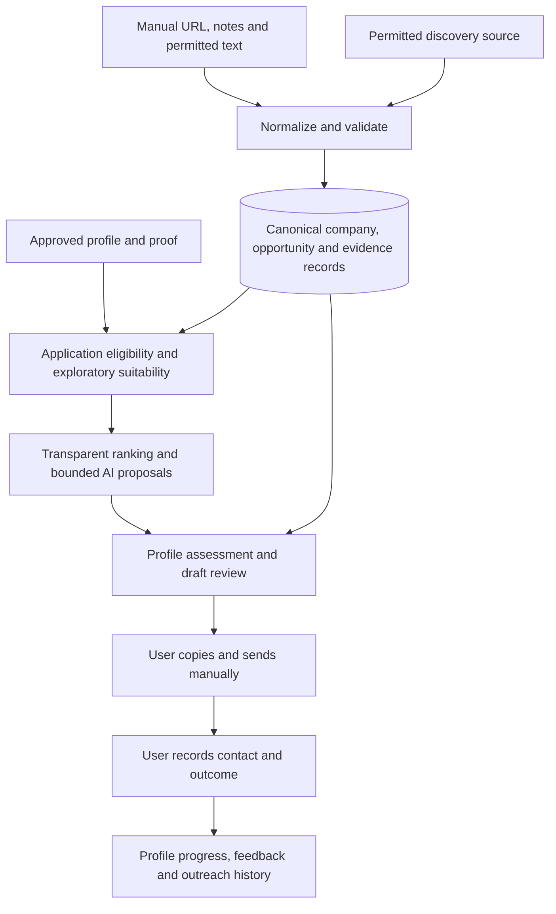

# Jobmaxxing: Founder-First Opportunity Intelligence

- **Status:** Proposed; awaiting product and architecture review.
- **Document date / documentation checked:** 2026-10-15.
- **Delivery scope:** Requirements and architecture only. Implementation requires separate approval.
- **Primary user:** A developer conducting a personal, founder-focused job search.
- **Product intent:** A local-first, open-source tool; personal data and credentials stay outside the source repository.

## 1. Product definition

### Problem

Promising engineering opportunities are scattered across startup job boards, founder posts, company websites and GitHub. Evaluating one opportunity requires repeatedly checking the company, the hiring signal, eligibility, the decision-maker and which genuine project best demonstrates fit. Generic application tools optimize submission volume and lose the evidence needed for a useful conversation.

Jobmaxxing should reduce that research and writing work while leaving judgment and communication with the user. It should help answer: **Is this company worth a conversation, can I credibly contribute, and what evidence should I mention?**

### Product in the user's workflow

1. Find or import a founder post, startup role or company of interest.
2. Attach it to a company dossier, retaining the original evidence and its age.
3. Check vacancy eligibility for an application, or assess whether an exploratory introduction is appropriate; keep these decisions separate.
4. Compare the company's needs with the user's approved skills and project proof.
5. Review a short explanation, missing information and a published professional contact path.
6. Edit a concise, supported message; copy it and send it manually if appropriate.
7. Record the contact, reply and eventual outcome.

The company is the organizing unit. A post is evidence; an opportunity is a particular role or explicitly unconfirmed conversation possibility at that company. Several posts may support one opportunity, and one company may have several distinct roles.

### Differentiators

- Founder and engineering-leader signals receive explicit attention alongside verified vacancies.
- A company dossier joins information across sources without collapsing distinct roles.
- Matching points to real portfolio evidence, not just shared keywords.
- Facts, user statements, model interpretations and unresolved conflicts remain distinguishable.
- Drafts include their evidence, contact provenance and uncertainty in the review view.
- Manual capture remains useful when a source blocks or does not authorize automation.
- One local installation works without a cloud account, autonomous agent or sending integration.

### Non-goals

- Application volume targets, bulk campaigns, automatic follow-ups or autonomous outreach.
- A LinkedIn Jobs clone, general recruiting platform or universal web crawler.
- Scraping restricted platforms, cookie reuse, fake accounts, anti-bot evasion or proxy rotation.
- Guessing email addresses, purchasing contact lists or collecting unrelated personal information.
- Fabricating experience, rewriting a resume without approval or treating repository ownership as proof of personal contributions.
- SaaS accounts, billing, tenancy, team collaboration, hosted deployment or shared databases.
- Vector search, learned ranking models, message brokers, microservices or required multi-agent orchestration.
- Legal determinations about employment eligibility or guaranteed interview outcomes.

### Success criteria

The primary outcome is discovering useful companies and founder-led opportunities the user would otherwise miss, with less repetitive research and better prepared conversations. Messages sent are an outcome to record, not a target to maximize.

For a small owner-reviewed pilot, propose the following targets before collecting results:

| Measure | Initial target | Interpretation |
| --- | --- | --- |
| Useful new leads discovered | At least 5 distinct companies not previously saved, across two review sessions, marked worth investigating | A new post for a known company is not a new company; exclude duplicates, resurfaced dismissals and user-imported individual leads from discovery credit |
| Founder / technical-leader discovery yield | Report useful leads with supported founder/leader attribution, self-claimed affiliation and unknown attribution separately | Provisional pilot target: at least 2 useful leads with supported attribution; do not call every company hiring post founder-led |
| Freshness and collection lag | Show age, last check and coverage for every lead; new items in a completed scan appear in that review session | Report publication-to-first-seen lag and last-check age; on-demand scans cannot guarantee coverage while the app is closed; do not invent edit dates |
| Discovery precision and coverage | Report useful new leads per unique company reviewed and items processed / available, including partial scans | Measure over the selected source/window, not the entire startup market; missing labels mean insufficient coverage |
| Usefulness of highest-ranked opportunities | At least 7 of the top 10 marked worth investigating | Owner judgment; show the denominator and all labels |
| Manual effort eliminated | At least 30% lower active time from discovery through reviewed draft over 10 comparable cases | Count browsing, copy/paste, company research and correction time against a timed manual baseline; report saved steps/minutes, not just faster text generation |
| Critical factual errors in reviewed drafts | Zero invented credentials, contacts or confirmed-vacancy claims | Any occurrence blocks release until corrected and regression checked |
| Safety invariants | All eligibility, approval and privacy checks pass | A high ranking cannot compensate for an invariant failure |
| Hiring classification | Precision and recall reported by signal class on the frozen evaluation set | No aggregate score hides false confirmed vacancies |

These are proposed acceptance targets, not measured results. Record replies and interviews, but a small personal pilot cannot establish causal hiring impact.

## 2. MVP boundary

### Smallest useful end-to-end release

The MVP is a single local web application that discovers previously unknown companies, presents cited hiring and founder context, matches a small approved proof library and prepares a truthful introduction for review. One active profile, one discovery source and manual sending are sufficient. The first independently useful slice must reach **Find leads → inspect company/evidence → assess contribution → review/copy introduction → save feedback**; a template/manual editor can precede model assistance.

| Included in MVP | Boundary |
| --- | --- |
| New-company discovery | Bounded scans of public monthly Hacker News hiring threads through the official API; choose sources/windows once rather than import every company. See section 5 for access, attribution and contact-purpose limits |
| Manual capture | Source URL, user's notes, known date and text the user has permission to process; URL-only records are valid |
| YC, Wellfound, LinkedIn and X source labels | Common normalized records; importing a URL never implies permission to fetch it |
| Company research | Start with the source's company/product description, attributed author and explicit links; user checks the company/founder and adds permitted evidence. Rich dossier enrichment follows demonstrated need |
| One profile and proof library | User-approved profile fields and proof points entered locally; links and authorized text first |
| Suitability and ranking | Separate job-application eligibility from exploratory-contact suitability; show contribution evidence, founder attribution and unknowns. Begin with simple explainable priority bands |
| Bounded AI assistance | Add one evaluated local adapter to extraction, company summaries and drafting in the next slice; preserve the manual/template path. Hermes and paid APIs are not prerequisites |
| Outreach drafts | One concise email/introduction editor with application versus exploratory intent; short social text and other formats can reuse it after the core loop works |
| Review and tracking | Edit, approve for manual use, copy, explicitly mark contacted, record replies and outcomes |
| Operational controls | Source enable/pause, stop new external reads/model requests, visible failures and usage history |
| Local durability | SQLite persistence, restart recovery, schema migrations and a documented backup/restore procedure |

For restricted sources, users can retain their own observations and source references without copying protected material. Text import is available only where the user has the necessary rights. Manual import is not a permission workaround. A restricted reference can be corroborated through a permitted company page or an authorized source.

Discovery is a core acceptance gate. Initially a user triggers **Find leads**; once a source is enabled, a due scan on app start may be explicitly opted into. No background service is required. The source selects new company leads without an employer watchlist, and the inbox distinguishes first discovery from later evidence updates.

If automatic thread selection fails, supplying one monthly thread URL still discovers its candidate companies through the official API; this is an independently useful fallback, not per-opportunity capture. If API access itself is unavailable or disallowed, retain the review workspace and permitted batch/manual imports but label live discovery unavailable. A Greenhouse-only watchlist or bookmark manager does not satisfy the founder-discovery MVP. Actual useful-lead yield must pass the pilot before claiming the source solves the goal.

### Explicitly deferred

- Greenhouse and Ashby watchlist collection, after the discovery-to-draft loop works; these verify/refresh known companies rather than replace discovery.
- General career-page fetching or structured JobPosting extraction; retain manual references initially.
- Automated YC, Wellfound or LinkedIn collection unless an authorized interface and use are verified.
- Paid X API or xAI X Search discovery, Hermes research, cloud model providers and any paid integration.
- Scheduling: add a user-started local scheduled command only when repeated manual refresh demonstrates a need; no daemon in the first release.
- PDF/DOCX resume parsing, GitHub account-wide ingestion, repository cloning and code execution.
- Human-approved, one-message email sending is a separately approved subsequent milestone, not part of the MVP or first implementation slice. DM/application sending, inbox sync, automatic follow-ups and browser automation remain deferred.
- Multiple active users, remote access, public dataset export and public hosting.

### Example MVP session

The user runs Find leads and sees a previously unknown startup from a public hiring thread. The tool shows the original post, company links, publication/observation times and whether the poster's founder role is supported or only claimed. The user checks the product and chooses a real project proof point. An explicitly invited application goes through vacancy eligibility checks; missing location information leaves that application unresolved. A separate company channel that welcomes general technical introductions may still support an exploratory message asking about fit, with location and role questions stated honestly. A job-only contact address is not repurposed for that introduction.

The user edits and approves the exact message for manual use, copies it, sends it outside the tool and records the outcome. The company remains a canonical record; this user's assessment, review progress and contact history belong to the profile. Restricted LinkedIn/X links can still supplement the dossier without being fetched.

## 3. Requirements and product rules

### R1. Capture and normalize hiring evidence

- Discovery must produce candidate companies without requiring the user to name each employer. Persist source/window, item limits, processed/available counts and first discovery time; show partial coverage and changed/previously seen items separately.
- Every signal retains source platform, acquisition method, original URL, native ID when available, observed collection time, publication time when available, employer attribution and supporting evidence.
- Publication time may be null. Collection, update and last-publication timestamps must not be relabeled as original publication dates.
- A URL-only import creates an incomplete reference, not an invented post body or verified opportunity. Display missing employer, date and evidence explicitly.
- Preserve the user's source URL; maintain a separate conservative canonical key for duplicate checks. Remove known tracking parameters only; retain parameters that identify content.
- Classify signals as `verified_vacancy`, `explicit_hiring_announcement`, `indirect_unconfirmed`, `not_hiring` or `uncertain`. Store the evidence and reason for classification.
- A verified vacancy requires a current, attributable employer/ATS role or an explicit role-specific announcement corroborated by an authorized representative. A general founder hiring post is not automatically a verified vacancy.
- Funding news, product launches, growth, old hiring posts, job-seeking posts, recruiter advertisements and talent pools do not establish an open role.
- Separate hiring certainty from employment type: full-time, part-time, internship, contract, freelance, temporary or unknown.
- Retain observed updates as evidence revisions when storage is permitted. Re-importing unchanged content must not create duplicate signals or opportunities.
- A failed refresh never proves a role closed. Missing listings after a successful complete refresh become `possibly_removed`; explicit closure or user verification establishes `closed`. Show last successful verification.

### R2. Company and person dossiers

- Company identity uses a verified company-controlled domain or corroborated native identifiers; names alone generate possible duplicate suggestions.
- Normalize casing, IDN representation, trailing slashes and a verified `www` alias. Do not collapse arbitrary subdomains, shared hosting domains, subsidiaries or same-name companies.
- Preserve source identities and an explicit alias/merge history. A user-confirmed merge must preserve notes, evidence, roles, drafts and outreach history; support correcting a mistaken association.
- Founder and leadership affiliations need evidence and observation dates. A shared name or a social handle alone does not establish identity or employment.
- Distinguish `supported_founder_or_leader`, `self_claimed`, `company_representative` and `unknown` author affiliation. Thread participation alone does not verify founder status; use source/context evidence rather than profile harvesting.
- The dossier presents product, verified stage/batch, people, open roles, technologies and plausible challenges. Each statement is labeled `supported`, `user_asserted`, `interpretation`, `unknown` or `conflict`.
- `supported` means attributable evidence exists, not independently guaranteed truth. Confidence must state its basis; model confidence is not a probability of truth.
- Contact channels are restricted to explicitly published professional/hiring channels with a source, intended purpose and last verification time. An application URL is a valid fallback; a public social profile does not prove its DMs are open.
- Preserve source-published contact purpose/restrictions as canonical facts; store this user's opt-outs, contact preferences and suppression history separately. Never infer an address from a domain/name pattern or use private or unrelated personal data.

### R3. Profile and proof library

- Store skills, preferences, target roles, experience, location/timezone, work authorization, remote/onsite preferences, employment types and optional compensation constraints locally.
- Hard preferences must be entered or confirmed by the user. Blank means unknown, not unrestricted. The user's actual constraints have not been supplied in this brief.
- Proof points contain a specific capability claim, project/contribution link, contribution description, supporting evidence and approval state. Repository ownership alone is insufficient.
- An inferred profile update or resume extraction is a proposal. Show the exact changes and require explicit save/approval before replacing profile facts.
- The AI may reference only approved proof points and approved profile fields. It must not add experience, metrics, credentials or claims of production use.
- Keep a profile revision on each match and draft. Changing hard constraints triggers reevaluation; changing proof invalidates affected draft approvals.
- Include `profile_id` in user-specific records, but expose one active profile and no account/tenant infrastructure.

### R4. Application eligibility and exploratory suitability

Maintain two profile-specific assessments. Neither changes canonical hiring certainty or the user's interaction progress.

**Application eligibility** evaluates a specific confirmed vacancy. Each applicable hard constraint returns `pass`, `fail`, `unknown` or `conflict`, with evidence: work authorization, geography, time overlap, arrangement, employment type and user-designated seniority/compensation limits. Any hard failure yields `ineligible`; unresolved constraints yield `needs_review`; all applicable constraints passing yields `eligible`. Without a confirmed role, application eligibility is `not_applicable`, not inferred eligibility. An empty profile cannot pass by default.

**Exploratory suitability** asks whether a truthful, relevant introduction is appropriate even without a confirmed vacancy:

- `suitable`: attributable company/product or engineering context, a genuine approved contribution proof point, user interest and a professional channel whose published purpose permits that introduction; no applicable hard conflict or suppression.
- `needs_review`: unresolved company/person identity, missing contribution evidence or unclear contact purpose. Keep the lead available for research; block approval until the relevant issue is resolved.
- `unsuitable`: do-not-contact, incompatible contact purpose, no supported contribution rationale, or a known hard constraint that rules out the proposed collaboration.

Unknown role title, seniority, salary or hiring geography does not automatically block an exploratory introduction. Surface those questions and use language such as asking whether the company could use that capability; do not claim a vacancy or eligibility. Require user-confirmed profile/proof and a purpose-compatible channel before approval. A published job-only address cannot be used for speculation, and a known ineligible role cannot be relabeled exploratory to evade its restrictions. A separate inquiry about another arrangement needs evidence that the company welcomes it.

AI cannot override hard failures, source/channel restrictions or opt-outs. Users may correct evidence or explicitly change preferences with a note; a score or message approval cannot substitute for permission. Remote does not imply worldwide eligibility, and unknown compensation is not a match. Closed-role applications remain blocked; a separate company inquiry needs its own valid rationale and channel.

The first slice uses explainable `high`, `consider` and `later` bands with a contribution reason, founder/leader attribution, signal age and missing information. Within each intent, `high` requires the relevant assessment to pass, supported founder/leader relevance, a cited proof point and a signal within 30 days or current verified need; `consider` covers plausible contributions needing research; `later` covers weak/stale fit or a user deferral. Known failures remain explicit regardless of band. Keep applications and exploratory leads visibly labeled; neither a band nor a score upgrades hiring certainty. Prioritize previously unseen useful companies without hiding credible employee-led signals.

After the first slice, the following proposed visible weights may refine ranking if owner feedback justifies them; they are not a prerequisite for discovery or drafting. Score within the selected application/exploratory intent, after displaying both assessment results. Weights sum to 100:

| Factor | Weight | Evidence required |
| --- | --- | --- |
| Demonstrable project fit | 30 | Approved proof points mapped to actual needs |
| Skill / contribution relevance | 20 | Application: requirement excerpts, required/preferred separate. Exploration: supported engineering/product context, without inventing role requirements |
| Company/product interest | 15 | User preferences and supported company description |
| Hiring signal strength | 15 | Classification and employer/author attribution |
| Freshness | 10 | Actual publication/verification basis and visible age |
| Professional contact path | 10 | Verified intended business channel or application route |

Use factor values `0`, `0.5`, `1` for absent/weak, partial and strong support, multiplied by weight. Unknown receives zero contribution with an explicit missing-data label; it is not a negative factual assertion. Do not renormalize around missing factors. Show evidence coverage separately. No model produces an opaque overall score.

For the initial freshness rule, use 1 for a dated signal within 14 days, 0.5 within 30 days and 0 thereafter. A successfully checked live role can receive 0.5 for current availability when its publication date is unknown, labeled with that distinct basis. Future/invalid dates require review. These thresholds are adjustable product defaults to evaluate, not facts about hiring behavior.

Unconfirmed leads retain an `unconfirmed` label in every view and can be ranked in the exploratory view. No score promotes them into a vacancy. Stable ties use evidence coverage, then last verification time, then record ID. Show reasons against a match as prominently as reasons in favor.

### R5. Research and AI contracts

- Separate `extract_signal`, `assess_fit` and `draft_message` operations behind a small model interface. No agent framework is required.
- Inputs reference bounded excerpts, approved proof points and relevant profile fields. Outputs use versioned schemas, allowed enums, explicit nulls, evidence references and uncertainty.
- Validate response shape, size, referenced IDs, profile ownership of private proof/evidence and supported values in application code before accepting any result. Canonical source evidence may support multiple profile assessments; another profile's private material may not. Reject unknown fields where appropriate.
- An evidence ID must refer to the relevant input and actually support the proposed claim. Shape validation alone does not establish accuracy; unresolved semantic claims remain interpretations for human review.
- Provider output never directly changes hard preferences, approves a draft, selects a new external destination or triggers a send.
- Malformed output or timeout preserves the source record and exposes an error. Permit at most one explicit bounded retry; no silent provider fallback, unbounded repair loop or hidden paid call.
- Record provider/model identifier, prompt/schema versions, input evidence/profile revisions, timestamps and available usage. Mark unavailable token/cost data unknown, never zero by assumption.
- Reuse an accepted result only for the same input/profile/prompt/model revisions. Do not build a generalized cache service.

### R6. Drafting, review and manual communication

Every draft review packet contains company/opportunity, application or exploratory intent, hiring certainty, both profile assessments with unknowns, cited company detail, contact-channel provenance/purpose, selected proof point, proposed recipient/channel and exact draft text. Application drafts require `eligible`; exploratory drafts require `suitable` and must acknowledge missing role information. An unknown contact remains unresolved rather than being invented.

- Select one specific need and one convincing approved proof point. Prefer natural, concise language; initial targets are 60–140 words for email and 25–70 for short social messages. These are editing guidelines, not claimed platform limits.
- Never claim personal familiarity, praise unsupported achievements, invent project metrics or describe an indirect signal as an opening.
- For a general application form, bind the draft to the exact published form URL and field purpose. Do not require an individual recipient where the intended channel is a verified form or team address.
- MVP draft state is `editing`, `approved_for_manual_use`, `stale` or `archived`. Approval is a distinct user action against a frozen draft revision, recipient/destination and channel.
- Editing subject/body, recipient, channel, proof, critical evidence or profile facts invalidates the approval. Revocation is available locally.
- Copying and approval do not mean a message was sent. The user must explicitly record actual contact, destination, time and message snapshot; if the externally sent text differs, record that actual text as user-reported history.
- Show prior contact and suppression status before approving or copying. Block approval for an active do-not-contact destination. Warn about a previous contact to the same person/channel/company, including across duplicate opportunities.
- Honor published communication preferences, including requests for no AI-generated/edited messages. For such a channel, offer source evidence and manual composition rather than an automated draft.
- Clipboard copy is always a user gesture. Provide a selectable-text fallback if clipboard permission is unavailable. Do not prefill an auto-submitting external form.
- HN discovery does not authorize generated HN comments/replies. Its guidelines prohibit generated or AI-edited posts; offer review/copy for a permitted external professional channel, not an AI-written HN response. [HN guidelines](https://news.ycombinator.com/newsguidelines.html)
- The MVP contains no sending tool, sending credentials, mail client integration or automatic application submission.

**Optional subsequent email milestone, outside MVP:** After explicit approval to build and connect one sender account, offer a user-initiated, one-recipient, text-only email workflow: review the complete From/To/subject/body and evidence → approve that exact email → send once → record the result. No bulk selection, autonomous trigger, follow-up sequence, CC/BCC, attachments or inbox synchronization. Choose one transport supported by the user's provider at that milestone; SMTP availability, OAuth scopes, cost and provider limits remain unverified. Python has an SMTP client if an approved account supports it; no provider is mandated. [Python smtplib](https://docs.python.org/3/library/smtplib.html)

**Sending invariant:** Manual-use approval is not send approval. The email executor must atomically validate an unexpired, unrevoked, single-use `email_send` approval binding sender account, exact recipient, channel, subject/body and attachments hash (none initially), draft revision and current suppression state. Changed content needs new approval. Persist an idempotency key and approval consumption with the attempt. An ambiguous provider timeout becomes `delivery_unknown` and requires reconciliation rather than an automatic retry; provider acceptance does not prove delivery. Pause must block new sends. Credentials are provisioned only with separate approval at the email milestone and remain outside Git, prompts and research tools. An agent's tool/command approval is not outreach approval.

### R7. Dashboard and feedback

The default view is a compact inbox of new company leads with why they were found, founder/leader attribution, evidence age, contribution rationale and the next useful question. Keep four dimensions separate: canonical hiring certainty/availability; profile-specific application eligibility; profile-specific exploratory suitability; and user interaction progress. Filters expose these independently alongside source, employment type, saved/priority and dismissed.

Interaction progress is **New → Reviewing → Contacted → Closed**, stored per profile/opportunity. It is not a combined qualification pipeline.

- Reviewing starts when the user chooses to investigate; missing job requirements do not prevent it. Draft readiness/approval is derived from R6 and draft state, not another workflow stage.
- Contacted requires an explicit manual outreach/application event, or a recorded accepted-send event after the optional email milestone. Copy, approval and opening a source cannot cause it; ambiguous sends remain separately unresolved.
- Replies, interview progress and outcomes are events with a visible latest-outcome label, not additional mandatory stages. Closed records a reason such as not interested, filled, rejected, accepted or no longer pursuing. A role becoming closed does not overwrite another profile's interaction history.
- Progress can be corrected with a history entry; do not fabricate skipped events. Save, dismiss, personal notes and priority are profile-specific flags.
- Persist notes and explicit feedback: relevant/irrelevant, interested/not interested, bad-match reason, contacted, positive/negative reply and outcomes.
- Feedback is profile-specific. Initially use it for suppression, user-visible preference edits and evaluated weight changes. Do not automatically retrain or silently alter hard constraints.
- Use labeled forms, keyboard access, visible focus, readable contrast and text labels alongside status colors. Show empty, error, stale, paused and model-disabled states.

## 4. Architecture proposal

### Runtime and components

Use one Python application, one SQLite database and a small server-rendered dashboard. No stack exists in the currently empty project directory; these are proposals rather than constraints inherited from code.

| Component | Proposed implementation | Responsibility |
| --- | --- | --- |
| Local UI and application routes | FastAPI, Jinja2 and simple CSS | Forms, list/detail views, review and operational controls |
| Source adapters | Small Python modules; official HN discovery plus manual import first | Find new companies; preserve provenance; add ATS verification adapters later |
| Persistence | Python `sqlite3`, numbered SQL migrations, parameterized queries | Domain records, provenance, revisions and run history |
| Qualification/ranking | Plain Python functions | Separate application eligibility, exploratory suitability and explained priority |
| Model adapter | HTTPX plus local Ollama initially, subject to evaluation | Structured extraction, relevance suggestions and drafting |
| Validation | Pydantic schemas and explicit semantic checks | Validate untrusted source/model boundaries |
| Research | User-supplied material and official source records | Evidence-backed dossier updates; optional Hermes later |
| Communication | Review/copy and manual event recording | Exact draft review; no executor in MVP |

FastAPI documents Jinja2 templates; Python documents SQLite as a disk database without a separate server. Pydantic provides model validation, HTTPX provides configurable timeouts, and Ollama documents schema-constrained local outputs. These capabilities justify the proposed small stack; they do not prove end-to-end quality or hardware fit. [FastAPI templates](https://fastapi.tiangolo.com/advanced/templates/), [Python SQLite](https://docs.python.org/3/library/sqlite3.html), [Pydantic models](https://docs.pydantic.dev/latest/concepts/models/), [HTTPX timeouts](https://www.python-httpx.org/advanced/timeouts/), [Ollama structured outputs](https://docs.ollama.com/capabilities/structured-outputs).

Use a supported Python version tested on Windows during implementation; do not select a version or model solely because documentation exists. Dependencies should be pinned and licenses checked when the implementation is approved. Avoid an ORM, frontend build pipeline and generalized plugin registry until an actual requirement justifies them.



### Data flow and failure boundaries

1. A discovery scan or manual import records acquisition metadata and coverage. Restricted URLs are stored as references without server fetching; source data cannot select new fetch targets or tools.
2. The adapter reads outside any write transaction. Enforce source-specific timeout, bounded response size and item limits; distinguish a complete fetch from a partial response.
3. Normalize identity and content, validate and transactionally save each accepted item with its evidence. Quarantine invalid items with a reason; never silently lose them.
4. Resolve company associations conservatively. Ambiguous employers remain unresolved until corrected.
5. Assess application eligibility and exploratory suitability independently. Model extraction/fit proposals pass the same evidence and schema checks before use; no model is needed for a template-based first slice.
6. Save the profile-specific assessment, draft and review progress separately from canonical company/opportunity records. Local edits remain available when external services fail.

Run one local application instance and serialize collection/model operations initially. Use short transactions and per-operation SQLite connections with foreign keys enabled; never hold a write lock during network/model work. A second concurrent collection request receives a clear busy state. No job broker or distributed worker is needed.

On restart, mark unfinished runs `interrupted`. Retrying an import/refresh reuses source identity and accepted content revisions; it does not duplicate domain records or reset workflow. Preserve partial progress and expose completed/failed counts. Do not automatically repeat interrupted model calls, particularly if a later provider can bill them.

### External actions and pause

MVP external activity consists only of explicitly enabled source reads and approved model requests. A persisted pause setting prevents new outbound operations, including retries. If a request is already in flight, display it and cancel where supported; pause cannot undo a transmitted request or guarantee a provider stopped processing it. Opening a source is a deliberate user action. Local inspection, edits and exports remain available while paused.

### Security and local data handling

- Bind the dashboard to loopback only. Validate Host/Origin, protect state-changing forms against cross-site requests and disable wildcard CORS. Loopback alone is not authorization against malicious websites.
- Keep the data directory outside the checkout, using the OS user-data location. Exclude secrets, resumes, profiles, snapshots, model payloads, databases, backups and logs from Git.
- The threat model assumes a trusted local OS account. SQLite is not encrypted by this design; rely on appropriate OS permissions and disk protection, and disclose that limitation.
- Default to no cloud inference, analytics or telemetry. A local model uses only an explicitly configured loopback endpoint. A cloud provider needs separate approval of destination, data categories, retention and any cost.
- Send only the minimum approved profile fields/proof excerpts to an enabled model. Business contact information can still be personal data; do not assume public availability permits transfer.
- Treat all posts, webpages, GitHub files and model responses as untrusted data. Delimit excerpts, constrain schemas and give extraction/drafting no filesystem, shell, credential, sending or arbitrary browsing tools.
- Network acquisition accepts only allowed HTTP(S) endpoints for an enabled adapter. Reject embedded credentials, local/private/link-local targets and unsafe redirects; revalidate resolved destinations. The configured local model endpoint is a separate explicit loopback exception, never a destination chosen by retrieved content.
- Render source HTML as escaped text; never execute scripts, embed remote tracking content or interpolate model text as HTML. Treat links as data and allow only safe schemes.
- Do not execute imported repositories, attachments or instructions to change prompts, reveal secrets, approve messages or contact anyone.
- Retain only necessary evidence excerpts and permitted snapshots. Source deletion/rights changes must remove or restrict affected stored content and invalidate dependent claims/drafts as required. A content hash is not a license to retain text.
- Provide user-controlled local backup/export and deletion with impact preview. Backups inherit sensitivity; avoid exporting third-party content where rights do not permit it. Deletion must account for drafts and derived copies; explain any retained minimal event metadata.

## 5. Source access and integration decisions

**Documentation review is not account authorization.** Before enabling an adapter, record the official interface, permitted purpose, applicable terms, credentials scope if any, storage/display/export rules, limits and date reviewed. Public accessibility, robots.txt or an unofficial library is insufficient on its own. Unknown access or reuse rights mean manual reference mode until resolved.

| Source | Current evidence and constraint | Product decision |
| --- | --- | --- |
| HN monthly hiring threads | Official API exposes public items; monthly thread rules expect company representatives, not necessarily founders. Published contact purpose still applies. | First new-company discovery source; bounded API reads, attributed evidence and separate founder verification. No HTML scraping, contact harvesting or generated HN replies. [Official API](https://github.com/HackerNews/API), [October thread](https://news.ycombinator.com/item?id=49922569), [HN-linked YC terms](https://www.ycombinator.com/legal/) |
| YC Jobs / Work at a Startup | YC publishes a job-search experience and terms; this review did not verify an official general job-discovery API or automation grant. Absence of a verified API is not proof none exists. | Prioritize manual discovery and URL/authorized-content import; do not depend on undocumented site endpoints. [YC Jobs](https://www.ycombinator.com/jobs), [YC terms](https://www.ycombinator.com/legal/) |
| Wellfound | Terms restrict copying/distributing content outside permission and contain candidate confidentiality obligations; a general discovery API grant was not verified. | Manual references and the user's own notes; copied content requires rights review. Do not transfer restricted employer communications to a model. [Wellfound terms, III–IV](https://wellfound.com/terms) |
| LinkedIn founder posts | LinkedIn prohibits unauthorized scraping/automation and restricts content copying; member-post read permissions are restricted. The Posts API is not verified as a general public founder feed for this use. | User-supplied references and permitted text only; no fetching, logged-in scraping, extension automation or background search. [LinkedIn prohibited software](https://www.linkedin.com/help/linkedin/answer/a1341387/prohibition-of-scraping-software?lang=en-us), [user agreement](https://www.linkedin.com/legal/user-agreement), [Posts API permissions](https://learn.microsoft.com/en-us/linkedin/marketing/community-management/shares/posts-api) |
| Greenhouse | Job Board GET endpoints are documented as public without authentication; application submission is a separate authenticated operation. Lists are scoped to a board token. | Subsequent verification/watchlist adapter: `GET https://boards-api.greenhouse.io/v1/boards/{board_token}/jobs?content=true`; no application POST. Keep update time separate from original publication; job detail may supply `first_published`. General-interest/prospect posts are not confirmed vacancies. [Job Board API](https://docs.greenhouse.io/job-board.html) |
| Ashby | Documents a job-board-specific public posting endpoint, optional compensation and `isListed`; `publishedAt` is last publication, not necessarily original creation. | Next adapter: `GET https://api.ashbyhq.com/posting-api/job-board/{board_name}?includeCompensation=true`. Automatic discovery excludes `isListed=false`; no private recruiting API credentials or application submission. [Public Job Postings API](https://developers.ashbyhq.com/docs/public-job-posting-api) |
| X, direct API | Official recent search covers seven days; full-archive access and account entitlements differ. Current docs describe paid usage. X policy imposes content-use and deletion obligations. | Manual import first. Later choose one paid provider only after access, storage/AI-use review and a bounded approved pilot. [X search](https://docs.x.com/x-api/posts/search/introduction), [pricing](https://docs.x.com/x-api/getting-started/pricing), [developer policy](https://docs.x.com/developer-terms/policy) |
| Company sites and GitHub | Company-specific reuse terms vary. GitHub REST permits public-data reads without authentication, with a general 60 requests/hour limit and separate tighter search limits. | Links/authorized excerpts first; later use approved company pages and narrow public GitHub reads. Cache within allowed policy, honor headers and avoid account-wide collection. [GitHub rate limits](https://docs.github.com/en/rest/using-the-rest-api/rate-limits-for-the-rest-api) |

### First discovery source and fallback

The proposed HN adapter uses the documented `whoishiring` user submissions and item endpoints to identify recent monthly hiring stories, then their direct child posts. `kids` is ranked order, not newest-first; `time` is creation time and there is no documented edit timestamp. Check author, title, type, parent and deletion/dead flags; exclude the separate job-seeker thread. Bound requests and expose scan coverage rather than claim exhaustive search. This is a proposed client of the official API, not runtime-validated collection. [Official HN API](https://github.com/HackerNews/API)

The product should select companies the user has not already saved, retain per-item identity and observed content changes, and show posts with relevant engineering needs. Founder/leader context gets priority when supported; a company representative's post alone does not prove founder leadership. Only the source account used to locate the thread needs a user-endpoint read; do not enumerate poster profiles or build a contact list. Author attribution, company resolution and useful-lead yield need owner-reviewed validation.

Fallback is one user-selected current hiring-thread URL, validated and read through the same API; it still discovers many candidates without individual imports. If that API cannot be used, pause discovery and offer source links plus permitted batch/manual capture with explicit degraded status. Do not replace it with scraping. Public hiring/product feeds may be evaluated later, but no such feed is assumed licensed, comprehensive or founder-specific here.

The official API is an intended access route; its documentation/license does not establish unrestricted downstream content, model-transfer or contact reuse rights. YC terms restrict unauthorized extraction and contact harvesting. The reviewed thread invites contact only for genuine interest in its jobs: keep an application-only destination restricted to that purpose. An exploratory introduction needs its own compatible invitation/channel. Store minimal permitted evidence; no bulk contact extraction or public dataset redistribution. [HN-linked YC terms](https://www.ycombinator.com/legal/), [reviewed thread rules](https://news.ycombinator.com/item?id=49922569)

Watchlists select companies the user is already interested in; they supplement discovery. The HN API does not authorize YC Jobs access, and neither Hermes, Grok nor a third-party search service bypasses source restrictions. Do not treat search snippets or AI summaries as authoritative underlying post content.

## 6. Logical data model

These are logical records and relationships, not a requirement to build every table before the first usable slice. Implement only the ordinary SQLite tables/fields needed by each milestone. Canonical means source-backed company/opportunity information within this local installation; it does not imply a shared service or permission to share the dataset. All timestamps use UTC with display in the user's timezone; unavailable dates remain null with a reason.

| Record | Essential fields and relationships |
| --- | --- |
| Company | `id`, display/legal names if known, verified primary domain, website, product summary, identity status, created/updated times; aliases/native identities retain source and evidence |
| Person / affiliation | Person `id`, professional display name, public professional URLs; company/person affiliation with role, founder/technical-leader flag, dates and evidence; uncertain identity never auto-merges |
| ContactChannel | `id`, company, optional person, kind, exact professional destination, source-published purpose/restrictions, evidence, last verification and availability; personal suppression belongs to profile state |
| Signal | `id`, optional resolved company/person, platform, acquisition method, native ID, original/canonical URLs, nullable published/updated dates with date semantics, first/last observed, classification, lifecycle and current evidence revision |
| Opportunity | `id`, company, role or unconfirmed company need, title/type, source-backed requirements, geography/authorization facts, hiring certainty, availability and evidence; many signals may support it; no profile, fit score, personal notes or workflow state |
| ProfileOpportunity | Unique `(profile_id, opportunity_id)`, first shown/reviewed, `new/reviewing/contacted/closed`, closure reason, saved/dismissed/manual priority and personal notes; profile-specific company flags may be stored alongside this local relationship |
| Profile | `id`, user-approved fields, hard/soft preferences, revision and approval timestamps; one active profile in MVP |
| ProofPoint | `id`, profile, capability claim, project/contribution URLs, personal contribution, evidence, approval status and revision |
| Evidence | `id`, source URL/native reference, permitted excerpt or local artifact reference, content hash/revision, published/observed times, source/acquisition, storage/transfer permissions, availability and retention restrictions |
| Claim / evidence links | Subject company/person/signal/opportunity/proof, field/value, `supported/user_asserted/interpretation/unknown/conflict`, evidence IDs, confidence basis and observation time; source facts can be canonical, but personal proof, fit interpretations and private notes retain profile scope |
| Assessment | Opportunity/profile and input revisions; application eligibility (including `not_applicable`), exploratory suitability, per-constraint results, contribution rationale, unknowns, priority band and later optional factor scores/weights; supporting/counter evidence and rules/model versions |
| Draft | Opportunity/profile, `application/exploratory` intent, intended person/destination, contact channel/purpose, subject/body, revision, referenced claims/proof, assessment/model run and draft state |
| Approval | Draft revision, profile, purpose (`manual_use` in MVP; `email_send` only later), exact destination/channel/content hash, approved-at, revoked/stale reason; future send approval also binds sender/account, expiration and consumption |
| OutreachEvent | Opportunity/profile/company, optional person/channel/draft/approval, event type, actual message snapshot when permitted, occurred/recorded time and outcome; origin `user_reported` in MVP; later distinguish attempted/provider_accepted/delivery_unknown without claiming delivery |
| Feedback / notes | Profile, subject opportunity/company/assessment, explicit decision and reason, timestamp; does not mutate hard preferences automatically |
| Source configuration | Platform/adapter, discovery thread/window or later company-board identity, enabled/paused state, reviewed access policy, coverage/continuation IDs and last successful refresh; secret reference only, never secret values |
| Processing run | Operation, source/model, input revisions, `started/succeeded/partial/failed/interrupted/cancelled`, counts, sanitized error, timestamps, attempts, model/prompt/schema versions and known usage/cost |

### Relationships and integrity

- Company has many people through affiliations, signals, opportunities and contact channels. Each canonical opportunity belongs to one company; separate roles remain separate opportunities. Profiles associate through ProfileOpportunity rather than duplicating the canonical role.
- Assessments, interaction progress, personal notes, feedback, drafts, approvals, suppression and outreach events belong to a profile. One profile's dismissal, eligibility failure or contact does not alter company facts or another profile's progress. Public channel restrictions and actual role closure remain canonical.
- Opportunity↔Signal and Claim↔Evidence are many-to-many. Proof belongs to a profile; a draft cannot borrow another profile's proof.
- Drafts reference exact approved proof and evidence revisions. Approval binds one immutable draft revision; outreach history is separate from draft status.
- A source observation may exist before its employer is resolved. It cannot become a ready opportunity until company attribution is established.
- Enforce native identity uniqueness within its source/board scope. Without a native ID, use canonical URL plus a versioned content hash; a text-only import can use a user-confirmed content fingerprint without pretending to have a public URL.
- Cross-source role similarity creates a merge suggestion. Do not auto-merge by title, person name or company name alone. A company merge does not merge its roles.
- Enforce foreign keys and transactional writes across evidence, signal links and run checkpoints. Never keep a visible supported claim whose evidence failed to persist.
- Provider outputs are proposals; user corrections win while preserving earlier evidence. Reclassification, changed constraints or unavailable evidence marks affected assessments/drafts stale.
- Removal policies can purge source text and dependent copies while retaining only permitted minimal identifiers/events. Provenance requirements never override a source's deletion obligations.

## 7. Build versus reuse

| Capability | Reuse | Build locally / decision |
| --- | --- | --- |
| Durable store | SQLite and Python standard library | Small domain schema and migrations; no database server or ORM initially |
| Dashboard | FastAPI templates, Jinja2, browser forms | Company list, evidence/draft review and tracking; no SPA framework |
| HTTP and validation | HTTPX, Pydantic | Source contracts, identity rules, evidence semantics and trust-boundary checks |
| Discovery and role verification | Official HN API first; Greenhouse/Ashby later | Find new companies through hiring threads; use ATS feeds to verify/refresh roles at selected companies; preserve source-purpose restrictions |
| Local inference | Ollama schema outputs | Three bounded task contracts; validate results and evaluate factual quality. Cloud structured-output parity is not assumed. [Ollama docs](https://docs.ollama.com/capabilities/structured-outputs) |
| Hermes Agent | MIT-licensed agent runtime with documented programmatic integration and configurable tools | Optional later research adapter only. Its sessions are not the domain database; require cited proposals through normal validation. Never delegate eligibility, approvals or sending. Pin and test a version before integrating. [Official repository](https://github.com/NousResearch/hermes-agent), [programmatic integration](https://hermes-agent.nousresearch.com/docs/developer-guide/programmatic-integration), [security](https://hermes-agent.nousresearch.com/docs/user-guide/security) |
| Grok with xAI X Search | Server-side X search in model requests, including citations and search controls | Optional paid discovery after MVP. Require claim-to-source mapping; citation URLs alone do not establish a hiring fact or exhaustive coverage. [X Search](https://docs.x.ai/developers/tools/x-search), [citations](https://docs.x.ai/developers/tools/citations) |
| Direct X API | Explicit search queries/pagination, separate developer access and billing | Alternative to xAI, not another MVP dependency. Pick one only after evaluating watched-founder coverage and cost. [X search docs](https://docs.x.com/x-api/posts/search/introduction) |
| Existing job-search/CRM OSS | Evaluate narrow components only if a concrete gap appears | Do not adopt a scraping-heavy aggregator or campaign platform as the foundation. No candidate has been installed, audited or validated in this pass |
| Scheduling | OS scheduler when needed | One idempotent local refresh command later; no scheduler service now |

Hermes may reduce multi-step research implementation work, but it adds tool permissions, runtime state and failure modes. Its documented command protections are not an OS capability sandbox and do not satisfy exact-message approval. The first release needs extraction and drafting rather than a general autonomous runtime. [Hermes security](https://hermes-agent.nousresearch.com/docs/user-guide/security).

### Optional X costs and privacy gates

As checked on 2026-10-15, xAI documents X Search at **$5 per 1,000 posts fetched and $10 per 1,000 profiles fetched, plus model tokens**. Repeated fetched items can count again. Direct X documents **$0.005 per post read and $0.010 per user read**, with prepaid credits and different billing deduplication rules. These are separate services; do not budget xAI as a flat price per query. [xAI pricing](https://docs.x.ai/developers/pricing), [xAI search usage](https://docs.x.ai/developers/tools/x-search), [X API pricing](https://docs.x.com/x-api/getting-started/pricing).

Illustratively, 500 fetched posts and 20 fetched profiles through xAI would be $2.70 in item charges, plus model tokens and any additional fetches. This is arithmetic from listed rates, not a usage estimate or budget approval. Actual invoice units, account terms, taxes, retries and future pricing require rechecking before activation.

Current xAI documentation describes default 30-day API retention; its Enterprise Terms section 11.2 requires personal data to be submitted through a ZDR-enabled API. Applicability to the actual account and ZDR eligibility remain unverified. Do not send resumes, private notes or person/contact dossiers to ordinary xAI calls by default. Even founder-handle discovery can involve personal data: verify applicable terms and data handling before enabling it. [xAI API security](https://docs.x.ai/developers/faq/security), [Enterprise Terms](https://x.ai/legal/terms-of-service-enterprise).

Any future paid provider needs explicit approval, a provider-side spend limit where available, application call/item/token limits, visible usage and a stop-before-next-request budget check. If a request's maximum cost cannot be bounded, label the application budget as an estimate and require an appropriate provider cap or explicit pilot limit before enabling it. No paid integration or resource is authorized by this PRD.

## 8. Implementation milestones and acceptance

All milestones below are planned work. This documentation pass has not implemented or tested an application. Each slice must be demonstrable independently and validated at its actual commit. Reach a useful discovery-to-draft loop before broadening sources, ranking or research. The logical model is a guide; do not build unused tables, generic audit infrastructure, resumable job frameworks or sending components upfront.

| Slice | User-visible result | Acceptance criteria |
| --- | --- | --- |
| M0: Approve first slice | Clear source, access boundaries and small pilot inputs | Explicit implementation approval; choose HN source/window or a verified permitted alternative, confirm source/contact-purpose rules and a few genuine proof points; define small adversarial cases. No model selection, paid API, sender account or full evaluation corpus is needed before M1 |
| M1: Discover → inspect → contribute → review/copy | User finds a previously unknown company and prepares a supported introduction in one local session | Bounded official-API scan works on a permitted real sample; one-thread seed fallback works; item IDs, dates, author affiliation and partial coverage are honest; relevant new companies deduplicated; user confirms company/channel and selects approved proof; application unknowns do not block a suitable exploratory draft, but known conflicts/job-only restrictions do; template/manual draft can be approved/copied without sending; personal feedback persists after restart; pause and basic trust-boundary probes pass |
| M2: Add bounded local AI and deeper assessment | Less source reading and drafting with evidence still visible | Evaluate one local model; proposals cannot overwrite hard preferences; application and exploratory results tested independently; schemas/references and factual draft checks pass; uncertain founder attribution and missing roles remain explicit; model failure leaves the M1 workflow usable. Add weighted ranking only if it improves the reviewed shortlist |
| M3: Validate a usable MVP | User repeatedly discovers useful leads and saves measurable effort | Freeze the relevant evaluation set before tuning; meet discovery/new-lead/founder-yield/effort targets or report gaps; restart, backup/restore, content removal, privacy and prompt-injection checks pass; document actual commands and local data location. M1–M3 form the MVP; a capture/watchlist-only result is not completion |
| M4: Optional ATS verification/watchlist | Better role verification and freshness at discovered companies | Add Greenhouse or Ashby only when observed leads need it; access/use review and permitted live sample; duplicates, prospect posts, updates, partial/429/403/timeouts and false closure checked. This slice supplements rather than replaces discovery |
| M5: Optional approved single-email send | User can review an exact email and send it once through one connected account | Separate implementation/connection approval; confirm one sender/provider and any cost/scopes; no credentials existed in M1–M3; From/To/content/purpose-bound single-use approval, revocation, duplicate suppression, pause, crash/double-click/idempotency and delivery_unknown behavior verified; use a local fake transport first, then a separately approved test email; provider acceptance is not delivery; no campaigns or autonomous follow-ups |

M4 and M5 are optional and can be chosen independently after M3; neither blocks the core MVP. Bounded permitted company-page research, Hermes, Grok/X discovery and scheduling need demonstrated benefit and separate approval where an agent framework, paid integration or external action is introduced. Run a small approved comparison before adopting a framework/provider; keep the adapter replaceable and the domain, privacy and approval rules local. Friend use begins with separate local installations, not tenancy or shared private records.

## 9. Verification plan

Use a few adversarial cases for the first vertical slice, then a permitted owner-labeled evaluation set for model tuning and MVP validation. Apply the following checks when the corresponding feature appears; do not require a complete multi-source test harness before M1. Separate synthetic checks, permitted live source reads and personal-use results. No paid calls, credentials or real personal profile material belong in CI.

For M2–M3, expand toward 40 authorized snippets/references, with 8 each for verified roles, explicit hiring announcements, indirect signals, non-hiring material and ambiguous/stale/conflicting cases. Include supported versus self-claimed founder attribution, negation, job seekers, closed roles, geographic restrictions and prompt injection. Freeze labels before model/weight tuning; use a separate development set. Also record first-seen companies, review labels, scan coverage and timed manual steps for discovery metrics. Missing coverage is `insufficient_coverage`, not passed; corpus preparation does not block the useful M1 slice.

| Area | Required checks / release evidence |
| --- | --- |
| Source normalization and discovery | HN correct-thread/author/parent checks, job-seeker thread exclusion, ranked rather than chronological children, deleted/dead/edited items, bounded/partial scans and one-thread fallback; URLs/dates/native IDs/rich text; show new companies versus new signals at known companies and preserve publication/observation semantics |
| Duplicate handling | Re-import unchanged and revised data; same company across platforms; same-name different companies; shared-domain tenants; two distinct roles; multiple role signals in one post; merge correction preserves dependent records |
| False hiring positives | Negated hiring, job-seeking posts, reposts, recruiter-only attribution, funding news, talent pools, historical/closed roles and ambiguous announcements; zero non-vacancies labeled verified in the frozen set; report precision/recall and false negatives by class |
| Eligibility and exploratory suitability | Vacancy with unknown location remains needs_review while a separate purpose-compatible exploratory introduction can be suitable; no vacancy yields not_applicable for application eligibility. Country/authorization/time/type/hard constraints and opt-outs still block relevant actions; job-only address cannot be repurposed; AI cannot override a known conflict |
| Canonical/profile separation | Two fixture profiles assess one canonical opportunity without duplicate company/role rows; dismiss/contact for one does not change the other's progress; private proof/notes cannot cross profiles; canonical role closure and public contact restrictions remain visible to both; no multi-user UI required |
| Provenance | Orphan evidence rejection, forged or cross-profile evidence IDs, conflicting claims, removed evidence and changed source revisions; supported dossier fields remain traceable or explicitly stale |
| Structured output | Invalid JSON, extra fields, wrong enums/types, huge responses, nonexistent IDs, unsupported claims, timeout and retry exhaustion; preserve original input and never promote malformed output |
| Draft accuracy | Every named company/person, role, metric, technology, project claim and contact checked against supplied evidence; no invented familiarity or credential; edited draft rechecked; concise channel-appropriate language judged by the user |
| Approval | Direct API/model attempts cannot approve; recipient/body/subject/channel/proof revisions invalidate approval; opt-out blocks approval; copy is not contact. At M5, manual approval cannot send; sender/recipient/content/send-purpose binding, revoked/expired approvals, double clicks, pause and ambiguous timeout/crash handling checked; no automatic retry of unknown delivery |
| Persistence/restart | Interrupt before fetch, during per-item commit and after accepted model output; no half-linked records/duplicate imports; interrupted status visible; drafts, notes, preferences and events survive; migration backup and restore integrity verified |
| Source/model failures | Offline use, 403, 429 with Retry-After, partial boards, invalid schema, slow responses and failed model; bounded retry, no data deletion/false closure, no hidden fallback, safe resume and current freshness labels |
| Prompt injection / content safety | Posts/README text requesting secrets, profile changes, system-prompt overrides, arbitrary URLs or sends; no such effect; escaped HTML, unsafe URL/redirect and cross-site request probes pass |
| Privacy / local operation | Loopback-only binding, safe origins, ignored sensitive paths, sanitized logs, no telemetry/cloud request in default mode, export/deletion impact checks and proof that pause blocks new outbound requests |
| Operational scale | Start with one bounded hiring-thread scan and a real review session; measure latency on the actual machine. Broader 5,000-signal/1,000-company/watchlist checks become relevant only when data growth requires them; do not delay the first slice for synthetic scale claims |

Report validation with commit SHA, exact command, fixture/data provenance, counts, outcome and skipped checks. Mocked provider responses establish adapter logic only. A live permitted read establishes that specific account/source interaction, not broad access rights or future reliability. A well-formed model response does not establish factual accuracy.

## 10. Risks and unknowns

| Risk / unknown | Impact | Mitigation or decision gate |
| --- | --- | --- |
| Restricted primary discovery platforms | LinkedIn/X/YC/Wellfound automation cannot be assumed | Begin with the official HN API and a one-thread seed fallback; gated/unknown rights stay restricted; if that source cannot be used, disclose discovery unavailable rather than declare capture-only MVP complete |
| Founder yield and discovery bias | A public hiring thread may mostly contain employee-led, established or unsuitable companies | Separate author claims from supported affiliation; measure new-company and founder/leader usefulness; approve another permitted source if yield misses the pilot target |
| Content-use rights and AI transfer | Manual copying or sending public personal data to a provider may still be restricted | Source-specific storage/transfer review; reference-only mode; minimal local excerpts; no default cloud processing |
| Stale or deceptive signals | Wasted research or inappropriate outreach | Dates and confidence basis visible; verify company/author; no closure from failed refresh; manual recheck before contact |
| Company/person identity mistakes | Wrong fit or recipient | Conservative matching, explicit identity evidence and correctable merges |
| Model hallucination / prompt injection | Invented claims, private-data exposure or unsafe actions | Bounded tasks without execution tools; schema/evidence validation; human approval and adversarial evaluation |
| Hard-constraint interpretation | Ineligible applications or unjustified exploratory contact | Distinct assessments; preserve fail/unknown/conflict and channel-purpose rules; unknown role details are questions, not evidence of eligibility or a universal contact block |
| Optional email execution | Duplicate/unauthorized sends or false delivery claims | Separate milestone and sender connection; exact single-use approval, opt-outs, pause and ambiguous-attempt reconciliation; never give sending tools/credentials to a model |
| Local model quality/hardware | Slow drafting or poor extraction | Evaluate on actual Windows hardware; manual mode; choose a model only after measured results |
| X provider cost/entitlements | Unexpected bills or incomplete discovery | Disabled by default; distinguish xAI/X billing; approved pilot and enforceable limits |
| Sensitive local files/backups | Disclosure through Git, logs or device access | Data outside checkout; ignore rules; staged-file inspection; restrictive local permissions and backup guidance |
| SQLite write contention/interruption | Missing or duplicate records | One process, serialized operations, short transactions, transactional checkpoints and restart tests |
| Bad feedback generalization | Narrow, self-reinforcing shortlist | Explicit reasons/weights; no silent preference changes; separate evaluation from tuning |
| Premature framework adoption | Operating the tool takes more effort than it saves | Domain owns data; optional adapters; defer Hermes, scheduling and paid discovery until evidence justifies them |
| Open-source distribution terms | A public repository alone does not grant reuse rights | Choose a license before distributing software; keep third-party/source content out of repository fixtures |

## 11. Material decisions for review

The following decisions need approval before their relevant milestone, not all before the first discovery slice. This revision does not approve implementation or connect any service.

| Decision | Proposed default | What needs the user's input |
| --- | --- | --- |
| M1 discovery source and success bar | Official HN hiring-thread discovery, supporting one thread URL as selection fallback; founder context verified separately | Approve this initial source/window and pilot targets, or identify an alternative with verified access. Broader LinkedIn/X coverage is not assumed; insufficient founder yield triggers a sourcing decision |
| M1 exploratory-contact policy | Permit truthful introductions with unknown role details when contribution and contact purpose are supported; continue blocking known hard conflicts and opt-outs | Confirm this distinction; supply a few approved proof points and personal hard exclusions during onboarding. Do not approve use of job-only channels for speculative contact |
| M2 AI/privacy boundary | Local Ollama after hardware/quality evaluation; M1 works without a model | Approve model selection at M2, or a specific cloud provider, permitted data and spending cap. Hermes/Grok require demonstrated benefit plus explicit approval rather than automatic adoption |
| M5 optional email workflow | One sender, one exact user-approved text email, disabled until separately authorized | Decide whether to build it after the core pilot; at that time approve provider/account, credential setup, scopes and cost. No sender connection is needed for M1–M3 |
| Open-source license | MIT is the proposed simple default for application code, subject to dependency/model license review | Confirm license before adding it or distributing implementation; this document does not apply a license |

Settled: repository name `jobmaxxing`, public visibility as previously requested, PRD at `docs/PRD.md`, single-user local architecture, no code implementation and no paid integration or outreach in this revision. Separate canonical records do not authorize multi-user sharing. Document review is not approval to implement, connect email, deploy or publish personal data.

## 12. Proposed configuration and operating contract

The following is an illustrative future configuration, not an implemented interface. It contains no credentials and does not create services:

```dotenv
# Local manual mode is the safe initial default.
JOBMAXXING_HOST=127.0.0.1
JOBMAXXING_PORT=8765
# Empty means the OS user-data directory, outside the checkout.
JOBMAXXING_DATA_DIR=
JOBMAXXING_NETWORK_PAUSED=true
JOBMAXXING_LLM_PROVIDER=disabled
# Only used after explicitly selecting local inference.
JOBMAXXING_LLM_BASE_URL=http://127.0.0.1:11434
JOBMAXXING_LLM_MODEL=
# Reserved for a separately approved cloud provider; never commit a value.
JOBMAXXING_LLM_API_KEY=
```

Source board names, access review, preferences and weights are local configuration/data, not environment-variable proliferation. Persist pause and source state in SQLite; an environment setting may force pause at startup. Credentials use environment variables or an approved OS mechanism, never database evidence or prompt text.

The later implementation must document installation, starting/stopping the local app, data location, source enablement, manual import, model-disabled operation, backup/restore, deletion and troubleshooting. No cloud resource, background service, credential change or deployment is needed for this architecture review.

## 13. Current verification status and stop condition

**Completed for the initial pass:** inspected the empty project directory; reviewed primary documentation for source access, optional integrations and cited costs; specified the architecture and verification gates. **This revision:** reviewed the current PRD, documented the official HN discovery route and contact restrictions, separated application eligibility from exploratory suitability, separated canonical/profile records and simplified delivery around the discovery-to-draft slice. Optional email remains a design milestone only.

**Not established:** live source permissions, account entitlements, retrieval quality, model/hardware suitability, actual API spend, pilot effectiveness or application correctness. No production code, runtime integration, automated test suite or real outreach has been executed as part of this PRD.

Stop after revising this document and reporting the affected decisions. Wait for explicit implementation approval before building any milestone. The first slice must demonstrate useful discovery and a supported introduction; additional autonomy, sources or infrastructure need measured justification.
